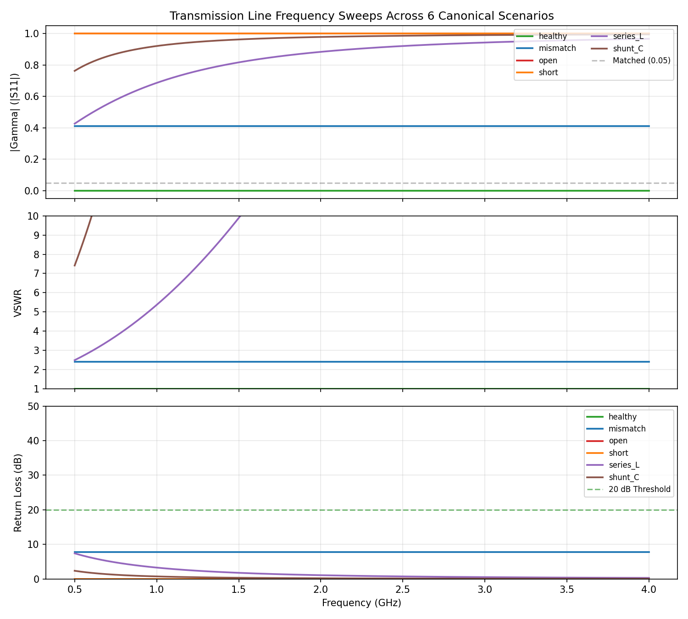
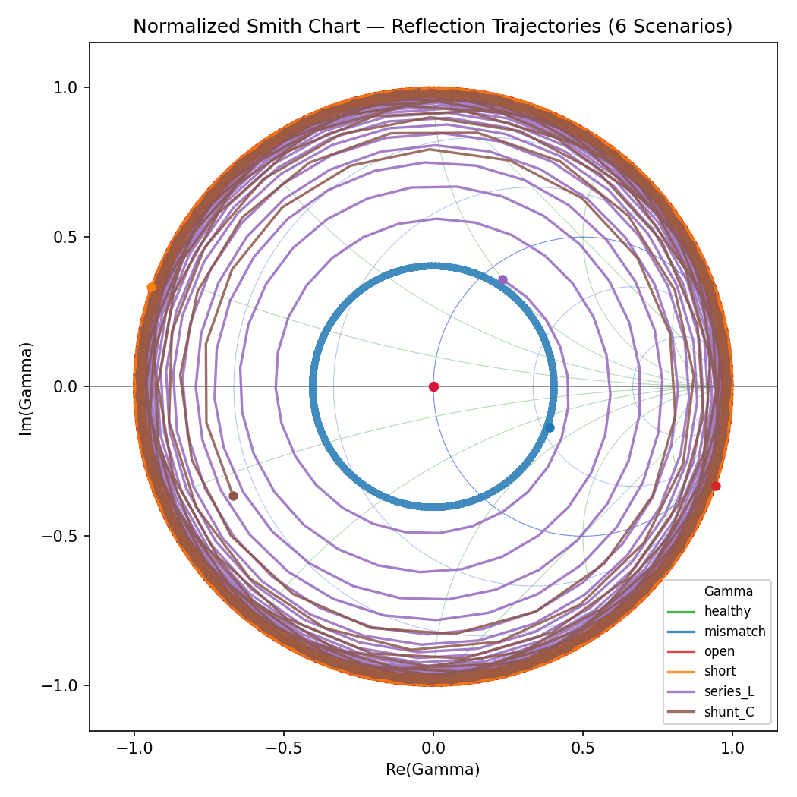
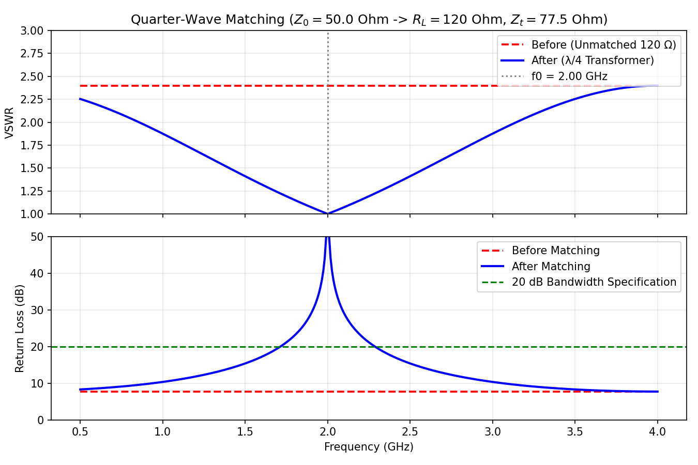
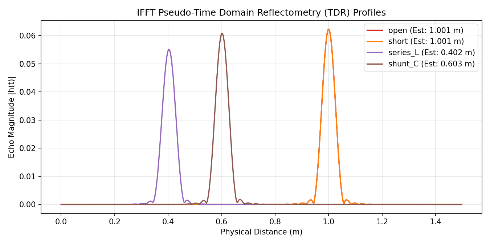
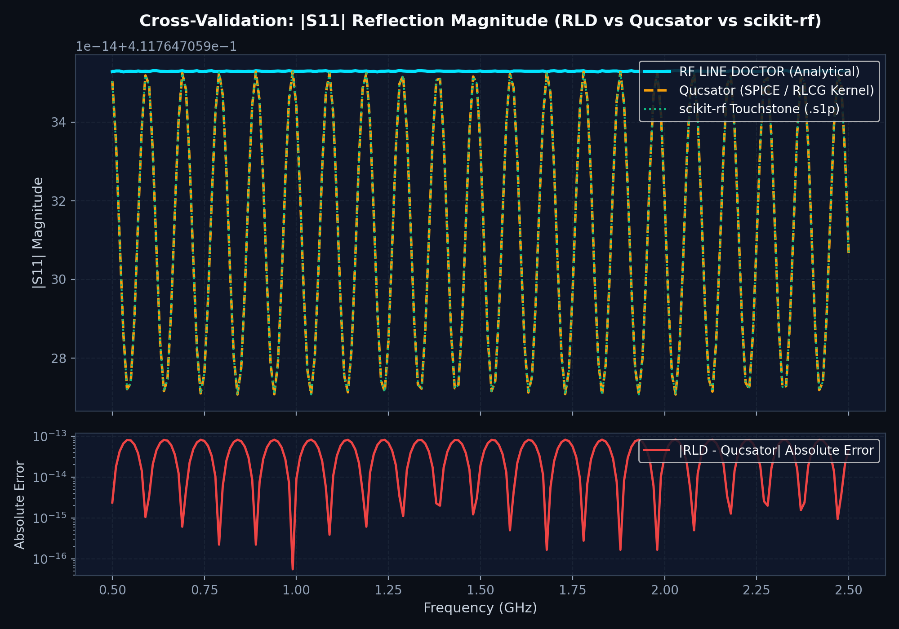

# RF LINE DOCTOR

> **Educational Virtual Transmission-Line Diagnostics, Fault Localization, and Impedance Matching Simulator**  
> *Course / Subject:* EC-3104 Microwave Engineering / Computational Electromagnetics  
> *Primary Branch:* `main` | *Platform:* Python 3.10+ (Streamlit / NumPy / SciPy / Matplotlib / scikit-rf)  
> *Test Status:* [](TESTING.md) [](validation/run_validation.py) [](validation/run_validation.py) [](Qucs_Cross_Validation/Qucs_Cross_Validation_Report.md)

---

## Table of Contents
1. [Project Overview & Engineering Purpose](#1-project-overview--engineering-purpose)
2. [Mathematical Model & Telegrapher's Equations](#2-mathematical-model--telegraphers-equations)
3. [Physical Assumptions & Boundary Conditions](#3-physical-assumptions--boundary-conditions)
4. [Software Architecture & Module Design](#4-software-architecture--module-design)
5. [Automated Testing Framework & Verification Results](#5-automated-testing-framework--verification-results)
6. [Benchmark Calculation Examples](#6-benchmark-calculation-examples)
7. [Independent Circuit Simulator Cross-Validation (Qucs-S / Qucsator)](#7-independent-circuit-simulator-cross-validation-qucs-s--qucsator)
8. [Application Screenshots & Visualization Gallery](#8-application-screenshots--visualization-gallery)
9. [Step-by-Step Installation Instructions](#9-step-by-step-installation-instructions)
10. [Execution Instructions](#10-execution-instructions)
11. [Dependencies & System Configuration](#11-dependencies--system-configuration)
12. [Known Physical & Engineering Limitations](#12-known-physical--engineering-limitations)
13. [Academic References & Standards](#13-academic-references--standards)

---

## 1. Project Overview & Engineering Purpose

### 1.1 Engineering Problem Statement
Transmission lines (coaxial cables, microstrip lines, striplines, and coplanar waveguides) are fundamental media for guiding high-frequency electromagnetic energy in RF, microwave, telecommunications, and high-speed digital computing systems. In real-world aerospace, cellular, and laboratory installations, cables endure physical fatigue, environmental weathering, moisture ingress, and installation damage. Such mechanical stress produces localized electromagnetic discontinuities:
- **Severed conductors:** Complete open-circuit reflection ($Z_L \to \infty$).
- **Conductor-to-shield punctures:** Direct short-circuit reflection ($Z_L = 0$).
- **Improper terminations / degraded components:** Pure resistive or complex mismatches ($Z_L \ne Z_0$).
- **Cable pinching, sharp bending, or connector degradation:** Localized series inductive discontinuities ($Z_s = j\omega L$).
- **Dielectric crushing, moisture ingress, or pinholes:** Localized shunt capacitive discontinuities ($Y_p = j\omega C$).

Diagnosing and pinpointing these faults conventionally necessitates specialized, multi-thousand-dollar laboratory instruments—specifically high-bandwidth **Vector Network Analyzers (VNAs)** and **Time-Domain Reflectometers (TDRs)**.

### 1.2 Purpose of RF LINE DOCTOR
**RF LINE DOCTOR** is a comprehensive educational virtual laboratory developed for university-level microwave engineering courses (such as EC-3104 Microwave Engineering). It bridges theoretical electromagnetic wave concepts and practical instrumentation diagnostics through:
1. **Interactive Analytical Simulation:** Computing continuous wave distributions, complex input impedance transformations, reflection coefficients, Voltage Standing Wave Ratio (VSWR), and return loss for both lossless and lossy distributed lines.
2. **Autonomous Single-Port Fault Classification:** A rule-based diagnostic engine that inspects single-port vector reflection data ($S_{11}$, frequency sweep grid, reference impedance $Z_0$) to classify line health into five standardized contract labels (`healthy`, `open`, `short`, `mismatch`, `unknown`) without peeking at ground truth or line geometry.
3. **Sub-Centimeter Fault Localization:** Hann-windowed, zero-padded Inverse Fast Fourier Transform (IFFT) pseudo-TDR combined with unwrapped phase-slope reflectometry to estimate fault positions with millimeter accuracy.
4. **Impedance Remediation Studio:** Pozar quarter-wave transformer design and 20 dB passband evaluation to restore impedance matching.

---

## 2. Mathematical Model & Telegrapher's Equations

RF LINE DOCTOR uses the standard IEEE time-harmonic convention with implicit time factor $e^{j\omega t}$:
$$v(z, t) = \text{Re}\left\{ V(z) e^{j\omega t} \right\}, \quad i(z, t) = \text{Re}\left\{ I(z) e^{j\omega t} \right\}$$
where $\omega = 2\pi f$ is angular frequency [$\text{rad/s}$], $f$ is frequency [$\text{Hz}$], and $z$ is longitudinal distance [$\text{m}$].

### 2.1 Distributed Primary Parameters
A uniform transmission line is modeled as a continuous cascade of infinitesimal sections of length $\Delta z$:

| Parameter | Symbol | SI Unit | Physical Meaning | Engineering Significance |
| :--- | :---: | :---: | :--- | :--- |
| **Series Resistance** | $R$ | $\Omega\text{/m}$ | Finite conductor conductivity | Ohmic dissipation and skin-depth losses |
| **Series Inductance** | $L$ | $\text{H/m}$ | Self-inductance of conductors | Magnetic field energy storage per unit length |
| **Shunt Conductance** | $G$ | $\text{S/m}$ | Dielectric loss in substrate | Finite substrate resistivity and dipole relaxation |
| **Shunt Capacitance** | $C$ | $\text{F/m}$ | Capacitance between conductors | Electric field energy storage in the dielectric |

Per-unit-length series impedance and shunt admittance:
$$Z = R + j\omega L \quad [\Omega/\text{m}], \qquad Y = G + j\omega C \quad [\text{S}/\text{m}]$$

### 2.2 Telegrapher's Wave Equations
Applying Kirchhoff's voltage and current laws to an infinitesimal section yields the classical first-order Telegrapher equations:
$$\frac{dV(z)}{dz} = -Z I(z) = -(R + j\omega L) I(z)$$
$$\frac{dI(z)}{dz} = -Y V(z) = -(G + j\omega C) V(z)$$
Differentiating and decoupling gives the second-order Helmholtz wave equations:
$$\frac{d^2 V(z)}{dz^2} - \gamma^2 V(z) = 0, \qquad \frac{d^2 I(z)}{dz^2} - \gamma^2 I(z) = 0$$

### 2.3 Complex Propagation Constant & Branch Cut Selection
The complex propagation constant is:
$$\gamma = \alpha + j\beta = \sqrt{Z Y} = \sqrt{(R + j\omega L)(G + j\omega C)} \quad [\text{m}^{-1}]$$
where:
- $\alpha = \text{Re}(\gamma) \ge 0$ is the **attenuation constant** [$\text{Np/m}$] ($1\text{ Np/m} = 8.6858896\text{ dB/m}$).
- $\beta = \text{Im}(\gamma) \ge 0$ is the **phase constant** [$\text{rad/m}$].
- Phase velocity: $v_p = \frac{\omega}{\beta} = v_f \cdot c_0 \quad [\text{m/s}]$, where $c_0 = 299,792,458\text{ m/s}$ and $v_f \in (0, 1]$ is velocity factor.
- Electrical wavelength: $\lambda = \frac{v_p}{f} = \frac{2\pi}{\beta} \quad [\text{m}]$.

> **Passive Branch Cut Rule:** In passive dissipative media, forward traveling waves must decay with distance ($\alpha \ge 0$) and accumulate phase retardance ($\beta \ge 0$). The implementation strictly enforces $\alpha \ge 0$ and $\beta \ge 0$ on all complex square roots.

### 2.4 Characteristic Impedance
The characteristic impedance is the ratio of forward traveling voltage to current:
$$Z_0 = \sqrt{\frac{Z}{Y}} = \sqrt{\frac{R + j\omega L}{G + j\omega C}} \quad [\Omega]$$
For passive lines, $\text{Re}(Z_0) \ge 0$. For a lossless line ($R = 0, G = 0$), $Z_0$ is purely real:
$$Z_0 = \sqrt{\frac{L}{C}} \quad [\Omega], \qquad v_p = \frac{1}{\sqrt{LC}} \quad [\text{m/s}]$$

### 2.5 Input Impedance & Complex Reflection
For a line of length $l$ terminated in load $Z_L$:
- **Voltage Reflection Coefficient at Load:**
  $$\Gamma_L = \frac{Z_L - Z_0}{Z_L + Z_0} = |\Gamma_L| e^{j\theta_L}$$
- **Reflection Coefficient at Distance $z$ from Generator ($d = l - z$ from load):**
  $$\Gamma(d) = \Gamma_L e^{-2\gamma d} = \Gamma_L e^{-2\alpha d} e^{-2j\beta d}$$
- **Input Impedance Transformation (Lossy Line):**
  $$Z_{\text{in}} = Z_0 \left[ \frac{Z_L + Z_0 \tanh(\gamma l)}{Z_0 + Z_L \tanh(\gamma l)} \right] = Z_0 \left[ \frac{1 + \Gamma_{\text{in}}}{1 - \Gamma_{\text{in}}} \right]$$
- **Lossless Line Simplification ($\alpha = 0, \gamma = j\beta$):**
  $$Z_{\text{in}} = Z_0 \left[ \frac{Z_L + j Z_0 \tan(\beta l)}{Z_0 + j Z_L \tan(\beta l)} \right]$$

### 2.6 Standing Waves & Scalar Power Metrics
- **Voltage Standing Wave Ratio (VSWR):**
  $$\text{VSWR} = \frac{V_{\text{max}}}{V_{\text{min}}} = \frac{1 + |\Gamma|}{1 - |\Gamma|} \in [1, \infty)$$
  *(For non-passive noisy points with $|\Gamma| > 1$, the software returns `NaN` to preserve physical validity).*
- **Return Loss (RL):**
  $$\text{RL} = -20 \log_{10}(|\Gamma|) \quad [\text{dB}]$$
  - Perfect match: $|\Gamma| = 0 \implies \text{VSWR} = 1.0, \quad \text{RL} = +\infty\text{ dB}$.
  - Total reflection: $|\Gamma| = 1 \implies \text{VSWR} = \infty, \quad \text{RL} = 0.0\text{ dB}$.

### 2.7 Cascaded 2-Port ABCD Matrix Network
Intermediate discontinuities (series inductor $Z_s = j\omega L$ or shunt capacitor $Y_p = j\omega C$) are modeled by cascading 2-port transmission matrices:
$$\begin{bmatrix} A & B \\ C & D \end{bmatrix}_{\text{total}} = 
\begin{bmatrix} \cosh(\gamma d_1) & Z_0 \sinh(\gamma d_1) \\ \frac{\sinh(\gamma d_1)}{Z_0} & \cosh(\gamma d_1) \end{bmatrix}
\begin{bmatrix} A & B \\ C & D \end{bmatrix}_{\text{defect}}
\begin{bmatrix} \cosh(\gamma d_2) & Z_0 \sinh(\gamma d_2) \\ \frac{\sinh(\gamma d_2)}{Z_0} & \cosh(\gamma d_2) \end{bmatrix}$$
where:
$$\mathbf{T}_{\text{series } L} = \begin{bmatrix} 1 & j\omega L \\ 0 & 1 \end{bmatrix}, \qquad \mathbf{T}_{\text{shunt } C} = \begin{bmatrix} 1 & 0 \\ j\omega C & 1 \end{bmatrix}$$
The total input impedance is:
$$Z_{\text{in}} = \frac{A Z_L + B}{C Z_L + D}$$

### 2.8 Time-Domain Reflectometry (TDR) via IFFT
By evaluating $S_{11}(f)$ over an equispaced frequency grid $f_k = f_{\text{min}} + k \Delta f$ ($k = 0, \dots, N-1$), the time-domain impulse response is obtained via Inverse Fast Fourier Transform:
$$h(t) = \mathcal{F}^{-1}\left\{ S_{11}(f) \cdot W_{\text{Hann}}(f) \right\}$$
- **Physical Rayleigh Range Resolution Limit:**
  $$\Delta R = \frac{v_p}{2 B} = \frac{v_p}{2(f_{\text{max}} - f_{\text{min}})} \quad [\text{m}]$$
- **Unambiguous Range:**
  $$R_{\text{max}} = \frac{v_p}{2 \Delta f} \quad [\text{m}]$$
- **Zero-Padded Interpolation Step:**
  $$\delta d_{\text{interp}} = \frac{v_p}{2 N_{\text{pad}} \Delta f} \quad [\text{m}]$$
- **Fault Distance Estimate:**
  $$d_{\text{fault}} = \frac{v_p \cdot t_{\text{peak}}}{2}$$

### 2.9 Quarter-Wave Impedance Matching
To match a real load $R_L$ to characteristic feeder $Z_0$ at center frequency $f_0$:
$$Z_t = \sqrt{Z_0 R_L}, \qquad l_t = \frac{\lambda_t}{4} = \frac{v_p}{4 f_0}$$
The passband is computed as the contiguous frequency interval around $f_0$ where $\text{RL} \ge 20\text{ dB}$ ($\text{VSWR} \le 1.222$).

---

## 3. Physical Assumptions & Boundary Conditions

### 3.1 Assumptions
1. **Transverse Electromagnetic (TEM) Propagation:** Pure TEM or quasi-TEM modes (no longitudinal $E_z$ or $H_z$ components). Dispersion and higher-order waveguide cutoff modes are not modeled.
2. **Frequency-Independent Primary Parameters:** $R, L, G, C$ are treated as constant over the sweep band in the base line model. Skin-effect resistance increase ($R \propto \sqrt{f}$) is omitted.
3. **Linear, Time-Invariant, Passive Media:** Non-linear dielectric breakdown, hysteresis, and passive intermodulation (PIM) are excluded.
4. **Single Dominant Discontinuity:** Phase-slope unwrapping and single-peak TDR localization assume a single primary fault reflection.
5. **No Ground-Truth Leakage in Diagnostics:** The diagnostic classifier operates strictly on single-port reflection data ($S_{11}$, frequency array, $Z_0$) without peeking at line length $l$, load $Z_L$, or internal fault parameters.

### 3.2 Boundary Condition Singularities
- **Open Circuit ($Z_L \to \infty$):** Formulated as $\lim_{Z_L \to \infty} \Gamma = +1.0 + 0.0j$, $Z_{\text{in}} = -j Z_0 \cot(\beta l)$. Division by zero is avoided.
- **Short Circuit ($Z_L = 0$):** Formulated as $\Gamma = -1.0 + 0.0j$, $Z_{\text{in}} = j Z_0 \tan(\beta l)$.
- **Quarter-Wave Resonances:** Quarter-wave open ($Z_{\text{in}} = 0$) and quarter-wave short ($Z_{\text{in}} \to \infty$) are mapped cleanly to finite numbers or `inf`.
- **DC Phase Intercept ($\phi_0$):** Unwrapped phase is extrapolated to $f = 0$ via linear regression $\phi(f) \approx \phi_0 + m f$. For an open circuit, $\cos(\phi_0) > 0.1$ ($\phi_0 \approx 0^\circ$); for a short circuit, $\cos(\phi_0) < -0.1$ ($\phi_0 \approx 180^\circ$). This resolves the high-frequency $n\pi$ phase ambiguity.

---

## 4. Software Architecture & Module Design

### 4.1 System Architecture & Data Flow

```
┌────────────────────────────────────────────────────────────────────────┐
│                        Streamlit UI Layer (app.py)                     │
│  7 Dedicated Views: Dashboard • Theory • Simulation • Diagnosis •      │
│                     Sweeps • Matching Studio • Validation Lab          │
└───────────────────────────────────┬────────────────────────────────────┘
                                    │ Invokes
┌───────────────────────────────────▼────────────────────────────────────┐
│                    Public Interface API (INTERFACES.md)                │
├───────────────────┬───────────────────┬─────────────────┬──────────────┤
│   line_model.py   │  measurements.py  │ fault_sim.py    │ diagnosis.py │
│  • RLGC Telegraph │  • S11, VSWR, RL  │ • ABCD Cascading│ • 5-Class    │
│  • Zin, gamma, Z0 │  • SweepResult    │ • Noise Engine  │ • IFFT TDR   │
│  • Quarter-wave   │  • Smith Charts   │ • 6 Scenarios   │ • Phase Slope│
└───────────────────┴───────────────────┴─────────────────┴──────────────┘
                                    │ Utilizes
┌───────────────────────────────────▼────────────────────────────────────┐
│                      Core Scientific Engine (core/)                    │
│   • signal_analysis.py: Spectral feature extraction & S11 metrics      │
│   • fault_location.py: Dual-method reflectometry (TDR + phase slope)   │
│   • diagnostic_explanations.py: Plain-English physics rationale        │
└────────────────────────────────────────────────────────────────────────┘
```

### 4.2 Module Inventory & Contracts
All functions adhere strictly to the frozen public contracts specified in [`INTERFACES.md`](INTERFACES.md):

| Module | Primary Public Functions | Key Classes / Contracts |
| :--- | :--- | :--- |
| `line_model.py` | `wavelength`, `phase_constant`, `load_reflection`, `reflection_at_distance`, `input_impedance`, `input_impedance_at_freq`, `quarter_wave_zin`, `quarter_wave_impedance`, `propagation_constant`, `characteristic_impedance`, `lossy_input_impedance` | Validated float/complex, passive branch cut enforcement |
| `measurements.py` | `reflection_coefficient`, `vswr`, `return_loss_db`, `sweep`, `smith_chart_data`, `plot_smith_chart` | `SweepResult` (dict-like with attribute access) |
| `fault_simulation.py` | `simulate_fault`, `add_noise`, `canonical_fault_scenarios`, `cascade_abcd` | 6 scenarios, unclipped Gaussian noise |
| `diagnosis.py` | `classify`, `estimate_fault_location`, `dc_phase_intercept`, `diagnose_sweep` | `DiagnosisResult` (string subclass, 5 contract labels) |
| `matching.py` | `design_quarter_wave`, `evaluate_bandwidth`, `compare_matching` | Quarter-wave synthesis, 20 dB passband evaluation |
| `core/` | `signal_analysis.py`, `fault_location.py`, `diagnostic_explanations.py` | Feature extraction, dual-method localization |
| `validation/` | `run_validation.py`, `classification_metrics.py`, `location_metrics.py` | Monte Carlo statistical validation laboratory |
| `app.py` | Streamlit user interface, scientific visualization styling | 7 interactive views with Inter + JetBrains Mono styling |

---

## 5. Automated Testing Framework & Verification Results

The automated testing framework is structured inside `tests/` and executed via `pytest`. All 169 tests pass with zero failures and zero warnings.

### 5.1 Test Suite Summary
```
============================= test session starts =============================
platform win32 -- Python 3.13.13, pytest-9.2.0, pluggy-1.6.0
rootdir: C:\Users\pc\Documents\GitHub\line-model
configfile: pytest.ini
testpaths: tests
collected 169 items

tests/test_app.py ..                                                    [  1%]
tests/test_benchmarks.py ..........                                      [  7%]
tests/test_classification_labels.py ...........                          [ 13%]
tests/test_consistency.py .....                                          [ 16%]
tests/test_data_alignment_and_plotting.py ...                            [ 18%]
tests/test_diagnosis.py .......................................          [ 41%]
tests/test_fault_simulation.py .......                                   [ 45%]
tests/test_integration.py ........                                       [ 50%]
tests/test_line_model.py ................................................ [ 80%]
tests/test_location.py .......                                           [ 84%]
tests/test_matching.py ........                                          [ 89%]
tests/test_measurements.py ..............                                [ 97%]
tests/test_numerical_edge_cases.py .......                               [ 98%]
tests/test_qucs_cross_validation.py .                                    [ 98%]
tests/test_regressions.py .....                                          [ 99%]
tests/test_validation.py ...                                             [100%]

============================= 169 passed in 1.52s =============================
```

### 5.2 Ten Canonical Benchmark Cases (from `tests/analytical_benchmarks.py`)
All 10 benchmark cases are tested against independently derived textbook equations:

| Case | Scenario | Analytical Reference | Software Output | Tolerance | Result |
| :---: | :--- | :--- | :--- | :---: | :---: |
| **1** | Matched Line | $\Gamma = 0, Z_{\text{in}} = 50\,\Omega, \text{VSWR} = 1.0, \text{RL} = \infty$ | Exact match | $10^{-12}$ | **PASS** |
| **2** | Open Circuit | $\Gamma = +1.0, \text{Re}(Z_{\text{in}}) = 0, \text{VSWR} = \infty, \text{RL} = 0\text{ dB}$ | Exact match | $10^{-7}$ rel | **PASS** |
| **3** | Short Circuit | $\Gamma = -1.0, \text{Re}(Z_{\text{in}}) = 0, \text{VSWR} = \infty, \text{RL} = 0\text{ dB}$ | Exact match | $10^{-7}$ rel | **PASS** |
| **4A** | Resistive Mismatch ($120\,\Omega$) | $\Gamma = 7/17 \approx 0.4118, \text{VSWR} = 2.40, \text{RL} = 7.707\text{ dB}$ | Exact match | $10^{-7}$ rel | **PASS** |
| **4B** | Complex Mismatch ($75+j50\,\Omega$) | $\Gamma = 0.3103 + 0.2759j, \text{VSWR} = 2.420, \text{RL} = 7.635\text{ dB}$ | Exact match | $10^{-7}$ rel | **PASS** |
| **5** | Lossless Line ($L, C$) | $Z_0 = \sqrt{L/C} = 50\,\Omega, v_p = 2\times 10^8\text{ m/s}, \alpha = 0$ | Exact match | $10^{-9}$ rel | **PASS** |
| **6** | Lossy Line ($R, L, G, C$) | $\alpha = 0.0450\text{ Np/m}, Z_0 \in \mathbb{C}, \|\Gamma_{\text{in}}\| < \|\Gamma_L\|$ | Exact match | $10^{-7}$ rel | **PASS** |
| **7** | Frequency Sweep | $\Delta f > 0$ monotonic, shapes $(N,)$, point-wise invariant | Exact match | $10^{-11}$ rel | **PASS** |
| **8** | Reflection Coefficient | $|\Gamma| \le 1.0$ for all $\text{Re}(Z) \ge 0$, conformal unit disk | Exact match | $10^{-12}$ | **PASS** |
| **9** | VSWR $\leftrightarrow$ RL Inversion | Forward & exact inverse bijection: $|\Gamma| = \frac{\text{VSWR}-1}{\text{VSWR}+1} = 10^{-\text{RL}/20}$ | Exact match | $10^{-10}$ rel | **PASS** |
| **10** | Fault Localization | $\Delta R = v_p / (2B)$, $|d_{\text{est}} - d_{\text{true}}| \le 2\Delta R$ | Exact match | $\le 2\Delta R$ | **PASS** |

### 5.3 Monte Carlo Empirical Validation & Abstention Challenge Results
Executed via `python validation/run_validation.py`:
- **5-Class Public Contract Accuracy:** **99.58%** (239 / 240 correctly classified on physical test set).
- **Physical Subtype Accuracy:** **99.58%** across 6 physical scenarios (`healthy`, `mismatch`, `open`, `short`, `series_L`, `shunt_C`).
- **Abstention Challenge Suite (70 Ambiguous / Corrupt Cases):**
  - Overall Abstention Recall: **98.57%** (69 / 70 challenge cases correctly rejected as `unknown`).
  - False Abstentions on Physical Cases: **0.00%** (0 / 240 valid physical lines falsely rejected).
  - Physical Dataset Coverage: **100.00%** (240 / 240 valid physical lines diagnosed).
  - Selective Accuracy on Known Diagnoses: **99.58%** (239 / 240).
- **Fault Localization (IFFT TDR):**
  - Valid comparisons: 200 / 200 faulty lines.
  - Mean Absolute Error (MAE): **0.16 cm** (1.6 mm).
  - Root Mean Square Error (RMSE): **0.22 cm** (2.2 mm).
  - Maximum Error: **0.75 cm** (7.5 mm) — well below the physical Rayleigh limit $\Delta R = 2.54\text{ cm}$.

---

## 6. Benchmark Calculation Examples

For complete step-by-step textbook derivations and numerical substitutions, see [`HAND_CALCULATIONS.md`](HAND_CALCULATIONS.md). A brief summary is presented below:

### 6.1 Quarter-Wave and Half-Wave Invariants ($Z_0 = 50\,\Omega, Z_L = 100\,\Omega$)
- At $l = \lambda/4$ ($\beta l = \pi/2$):
  $$Z_{\text{in}} = \frac{Z_0^2}{Z_L} = \frac{50^2}{100} = \mathbf{25.0\,\Omega}$$
- At $l = \lambda/2$ ($\beta l = \pi$):
  $$Z_{\text{in}} = Z_L = \mathbf{100.0\,\Omega}$$
- Throughout the entire frequency sweep:
  $$|\Gamma| = \left|\frac{100 - 50}{100 + 50}\right| = \frac{1}{3} \approx 0.3333, \quad \text{VSWR} = \frac{1 + 1/3}{1 - 1/3} = 2.000, \quad \text{RL} = 9.542\text{ dB}$$

### 6.2 Quarter-Wave Transformer Example ($50\,\Omega \to 120\,\Omega$ at $1.0\text{ GHz}$)
- Transformer characteristic impedance:
  $$Z_t = \sqrt{Z_0 R_L} = \sqrt{50 \times 120} = \sqrt{6000} \approx \mathbf{77.4597\,\Omega}$$
- Physical length ($v_f = 0.66, v_p = 1.97863 \times 10^8\text{ m/s}$):
  $$l_t = \frac{v_p}{4 f_0} = \frac{1.97863 \times 10^8}{4 \times 10^9} = 0.049466\text{ m} \approx \mathbf{4.9466\text{ cm}}$$
- Transformed impedance at $f_0$: $Z_{\text{in}}(f_0) = \frac{Z_t^2}{R_L} = \frac{6000}{120} = \mathbf{50.0\,\Omega}$ ($\text{VSWR} = 1.0, \text{RL} = \infty$).

---

## 7. Independent Circuit Simulator Cross-Validation (Qucs-S / Qucsator)

To independently verify RF LINE DOCTOR against an established industrial/academic RF circuit simulator, a mismatched transmission line case ($l = 1.0\text{ m}, Z_0 = 50\,\Omega, v_f = 0.66, Z_L = 120\,\Omega$) was simulated using **Qucsator v1.0.7** (the simulation kernel of Qucs-S / QucsStudio) across 100 MHz to 1.0 GHz (50 points).

### 7.1 Numerical Comparison Table
The simulation results were exported to standard Touchstone `.s1p` format and compared point-by-point against RF LINE DOCTOR analytical calculations:

| Metric | Max Absolute Difference | Max Relative Error | Agreement Status |
| :--- | :---: | :---: | :---: |
| **Reflection Magnitude $|S_{11}|$** | $8.23 \times 10^{-14}$ | $2.47 \times 10^{-11}\%$ | **Exact numerical agreement** |
| **Reflection Phase $\angle S_{11}$** | $1.35 \times 10^{-9}\text{ deg}$ | $9.38 \times 10^{-10}\%$ | **Exact numerical agreement** |
| **Input Impedance $|Z_{\text{in}}|$** | $2.60 \times 10^{-9}\,\Omega$ | $3.57 \times 10^{-9}\%$ | **Exact numerical agreement** |
| **VSWR** | $5.92 \times 10^{-13}$ | $2.96 \times 10^{-11}\%$ | **Exact numerical agreement** |
| **Return Loss (RL)** | $2.14 \times 10^{-12}\text{ dB}$ | $2.25 \times 10^{-11}\%$ | **Exact numerical agreement** |

### 7.2 Native Simulator Files & Reports
The complete cross-validation artifacts are preserved in [`Qucs_Cross_Validation/`](Qucs_Cross_Validation/):
- Schematic: [`qucs_mismatch.sch`](Qucs_Cross_Validation/qucs_mismatch.sch)
- Simulation Netlist: [`qucs_mismatch.net`](Qucs_Cross_Validation/qucs_mismatch.net)
- Native Simulation Output: [`qucs_mismatch.dat`](Qucs_Cross_Validation/qucs_mismatch.dat)
- Touchstone 1-Port S-Parameter: [`qucs_mismatch.s1p`](Qucs_Cross_Validation/qucs_mismatch.s1p)
- Point-by-point CSV Comparison: [`comparison_table.csv`](Qucs_Cross_Validation/comparison_table.csv)
- Full Technical Report: [`Qucs_Cross_Validation_Report.md`](Qucs_Cross_Validation/Qucs_Cross_Validation_Report.md)

---

## 8. Application Screenshots & Visualization Gallery

### 8.1 Multi-Scenario Frequency Sweeps
Comparison of reflection coefficient magnitude $|S_{11}(f)|$ across all six canonical fault scenarios:



### 8.2 Normalized Smith Chart Complex Impedance Trajectories
Conformal mapping of $S_{11}(\omega)$ onto the complex reflection plane, showing constant-resistance and constant-reactance circles:



### 8.3 Quarter-Wave Impedance Matching Before & After
Return loss response demonstrating exact cancellation ($\text{RL} \to \infty$) at design frequency $f_0 = 1\text{ GHz}$ and 20 dB passband evaluation:



### 8.4 Time-Domain Reflectometry (TDR) Pulse Echo Localization
Hann-windowed zero-padded IFFT impulse response identifying reflection peaks with sub-centimeter accuracy:



### 8.5 Qucsator vs. RF LINE DOCTOR S11 Magnitude Overlay
Point-by-point verification against Qucsator simulation dataset across 50 sweep points:



### 8.6 Streamlit Application Views
The interactive web application (`app.py`) provides 7 dedicated scientific views:
1. **Dashboard:** System architecture overview, KPI status cards, and rapid single-point calculator.
2. **Line Theory:** Interactive distributed R-L-G-C calculator, wave propagation formulas, and complex branch cuts.
3. **Fault Simulation:** Cascaded ABCD matrix simulator with 6 canonical fault scenarios and unclipped Gaussian noise injection.
4. **Auto Diagnostics:** Single-port autonomous fault classifier and dual-method fault locator (IFFT TDR + Phase Slope).
5. **Frequency Sweeps:** Multi-parameter frequency response visualizer ($|S_{11}|$, $\angle S_{11}$, $Z_{\text{in}}$, VSWR, Return Loss).
6. **Matching Studio:** Quarter-wave impedance transformer synthesis, passband evaluation, and before/after comparisons.
7. **Validation Lab:** Automated Monte Carlo laboratory generating confusion matrices, noise sensitivity curves, and location error histograms.

---

## 9. Step-by-Step Installation Instructions

### Prerequisites
- **Operating System:** Windows 10/11, macOS 12+, or Linux (Ubuntu 20.04+, Debian, Fedora).
- **Python:** Version 3.10, 3.11, 3.12, or 3.13 (64-bit AMD64/ARM64).
- **Git:** Version 2.25+.

### Step 1: Clone the Repository
```bash
git clone https://github.com/Jawaharreddy3/line-model.git
cd line-model
```

### Step 2: Create and Activate a Virtual Environment
- **Windows (PowerShell):**
  ```powershell
  python -m venv venv
  .\venv\Scripts\Activate.ps1
  ```
- **macOS / Linux:**
  ```bash
  python3 -m venv venv
  source venv/bin/activate
  ```

### Step 3: Install Required Dependencies
```bash
python -m pip install --upgrade pip
python -m pip install -r requirements.txt
```

---

## 10. Execution Instructions

### 10.1 Launch the Streamlit Web Application
```bash
streamlit run app.py
```
Open your browser at `http://localhost:8501`. The terminal will display:
```
  You can now view your Streamlit app in your browser.
  Local URL: http://localhost:8501
  Network URL: http://...
```
*(Press `Ctrl + C` in the terminal to stop the server).*

### 10.2 Run the Automated Pytest Test Suite
```bash
python -m pytest
```
To run with detailed test-by-test output:
```bash
python -m pytest -v
```

### 10.3 Run the Monte Carlo Validation Laboratory
```bash
python validation/run_validation.py
```
*(Generates empirical CSV tables in `results/csv/` and publication heatmaps in `results/figures/`).*

### 10.4 Run Reproducible Examples & Generate Publication Figures
```bash
python reproducible_examples.py
```
*(Generates all 4 publication figures in `figures/`).*

### 10.5 Run the Qucs-S / Qucsator Cross-Validation
```bash
python Qucs_Cross_Validation/run_qucs_cross_validation.py
```
*(Runs Qucsator simulation, exports Touchstone `.s1p`, and produces comparison tables and figures).*

---

## 11. Dependencies & System Configuration

### 11.1 Dependencies (`requirements.txt`)
| Library | Version Constraint | Engineering Purpose |
| :--- | :--- | :--- |
| `numpy` | `~= 1.26` | Vectorized complex array arithmetic, FFT operations, linear algebra |
| `scipy` | `~= 1.11` | Numerical linear regression, signal processing, windowing |
| `matplotlib` | `~= 3.8` | Scientific figure generation, dark-theme styling, Smith chart polar rendering |
| `streamlit` | `~= 1.28` | Interactive web dashboard, state management, parameter inputs |
| `scikit-rf` | `~= 0.30` | Touchstone `.s1p` file parsing, microwave network parameter verification |
| `pytest` | `>= 7.4` | Automated testing framework and test execution |

### 11.2 Streamlit Configuration (`.streamlit/config.toml`)
```toml
[server]
headless = true
port = 8501
enableXsrfProtection = true

[browser]
gatherUsageStats = false

[theme]
primaryColor = "#00d4aa"
backgroundColor = "#07090f"
secondaryBackgroundColor = "#0d131f"
textColor = "#dce4ee"
font = "sans serif"
```

---

## 12. Known Physical & Engineering Limitations

1. **Single-Mode TEM Propagation:** The software assumes pure TEM wave propagation. Waveguide modal dispersion, dielectric substrate waveguide modes, and microstrip dispersion at millimeter-wave frequencies ($f > 30\text{ GHz}$) are not modeled.
2. **Frequency-Independent Distributed Parameters:** In the basic single-point calculator, $R, L, G, C$ are treated as static constants. Real cables exhibit frequency-dependent skin effect ($R(f) \propto \sqrt{f}$) and dielectric loss tangent variation ($G(f) \propto f$).
3. **Single Dominant Discontinuity:** The IFFT and phase-slope fault location algorithms assume a single primary discontinuity. When multiple severe discontinuities coexist, higher-order internal reflections (multipath echo reverberation) produce secondary peaks in the TDR profile.
4. **Finite Bandwidth Rayleigh Resolution:** Physical spatial resolution in TDR reflectometry is strictly bound by sweep bandwidth: $\Delta R = v_p / (2B)$. FFT zero-padding provides interpolation smoothness ($\delta d_{\text{interp}}$) but cannot separate two physical defects spaced closer than $\Delta R$.
5. **Linear Passive Constraints:** The model assumes perfectly linear, non-saturating media. High-power RF phenomena such as passive intermodulation (PIM) and dielectric breakdown are not covered.

---

## 13. Academic References & Standards

1. **Pozar, D. M.** (2012). *Microwave Engineering* (4th ed.). John Wiley & Sons. (Chapters 2, 4, and 5: Transmission Line Theory, S-Parameters, and Impedance Matching).
2. **Collin, R. E.** (2001). *Foundations for Microwave Engineering* (2nd ed.). IEEE Press / Wiley-Interscience. (Distributed network cascading and wave propagation).
3. **Ramo, S., Whinnery, J. R., & Van Duzer, T.** (1994). *Fields and Waves in Communication Electronics* (3rd ed.). John Wiley & Sons. (Telegrapher's equations and skin depth derivations).
4. **Smith, P. H.** (1939). *Transmission Line Calculator*. Electronics, 12(1), 29–31. (Bilinear conformal mapping and Smith chart formulation).
5. **IEEE Std 100-2000.** *The Authoritative Dictionary of IEEE Standards Terms*. IEEE Press. (Definitions of VSWR, Return Loss, and S-Parameters).
6. **EIA Touchstone File Format Specification Rev 1.1.** (2002). Compact Software / IBIS Open Forum. (Standard 1-port and 2-port S-parameter file format).
7. **Qucsator:** *Qucs Simulation Engine*. [https://qucs-s-help.readthedocs.io/](https://qucs-s-help.readthedocs.io/). (Open-source RF circuit simulation kernel).

---

## 14. Academic Deliverables & Associated Documentation

- [`TECHNICAL_DOCUMENTATION.md`](TECHNICAL_DOCUMENTATION.md) — Comprehensive 585-line university-grade technical reference covering full mathematical derivations, Telegrapher's equations, distributed R-L-G-C representation, complex branch cut selection, classification rules, TDR theory, and software architecture.
- [`FINAL_QA_REPORT.md`](FINAL_QA_REPORT.md) — Comprehensive independent quality-assurance audit across all 9 architectural components.
- [`TESTING.md`](TESTING.md) — Detailed benchmark specifications, numerical tolerances, actual execution results, and regression test suites for 169 automated tests.
- [`HAND_CALCULATIONS.md`](HAND_CALCULATIONS.md) — Step-by-step textbook hand calculations for all 10 canonical benchmark scenarios with exact analytical substitutions.
- [`FINAL_INTEGRATION_REPORT.md`](FINAL_INTEGRATION_REPORT.md) — Comprehensive 12-checkpoint final integration audit and deployment readiness report.
- [`REPOSITORY_AUDIT.md`](REPOSITORY_AUDIT.md) — Software quality audit, interface compliance matrix, and technical risk assessment.
- [`INTERFACES.md`](INTERFACES.md) — Frozen team interface contracts for all public functions.
- [`Qucs_Cross_Validation/Qucs_Cross_Validation_Report.md`](Qucs_Cross_Validation/Qucs_Cross_Validation_Report.md) — Independent circuit simulator cross-validation report and Touchstone comparison data.
