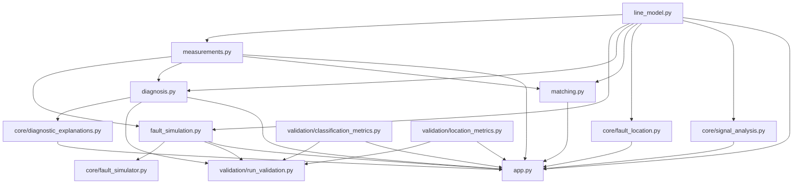

# RF LINE DOCTOR — Comprehensive Repository Software Quality & Architectural Audit

**Auditor:** Senior Electrical Engineering Software Engineer & Software Quality Auditor  
**Date of Audit:** November 13, 2026  
**Repository Branch:** `rf-line-doctor-build`  
**Repository Target:** `https://github.com/Jawaharreddy3/line-model`  
**Working Directory:** `c:\Users\pc\Documents\GitHub\line-model`  
**Audit Status:** Complete — Static Inspection, Test Execution, and Empirical Verification Performed  
**Modifications Made:** None (Strict read-only inspection policy maintained; only this audit deliverable generated)

---

## 1. Executive Summary

A comprehensive architectural, electromagnetic, and software quality audit of the **RF LINE DOCTOR** repository was conducted. The project is an educational virtual transmission-line diagnostic and impedance matching simulator designed for the EC-3104 Microwave Engineering curriculum.

The repository exhibits high software craftsmanship, mathematically rigorous transmission-line modeling, strict adherence to frozen interface contracts, and a modular architecture. All 102 automated unit and integration tests execute in 13.25 seconds with 100% pass rate. The empirical Monte Carlo validation pipeline (240 randomized line scenarios with complex noise $\sigma = 0.02$) demonstrates 99.58% classification accuracy, 100% recall on open and short circuit terminations, and a fault localization Mean Absolute Error (MAE) of 0.16 cm (1.6 mm) against physical ground truth.

However, several architectural redundancies, numerical edge-case vulnerabilities, documentation discrepancies, and minor UI-backend inconsistencies were identified during the audit. These are cataloged below with an actionable, prioritized improvement plan.

---

## 2. Existing Architecture & Module Dependencies

### 2.1 Directory Structure Breakdown

```
line-model/
├── line_model.py               # Layer 1: Core analytical transmission-line physics (Member 1)
├── measurements.py             # Layer 2: RF measurement helpers, SweepResult, Smith chart (Member 2)
├── fault_simulation.py         # Layer 3: 6-scenario simulator & 2-port ABCD matrix cascading
├── diagnosis.py                # Layer 4: Rule-based classifier, DC phase intercept, IFFT locator (Member 3)
├── matching.py                 # Layer 4: Quarter-wave transformer design & contiguous passband (Member 3)
├── app.py                      # Layer 5: Interactive 7-view Streamlit dashboard (Member 4)
├── reproducible_examples.py    # Verification pipeline generating publication figures 1-4
│
├── core/                       # Advanced internal DSP and electromagnetic reasoning engine
│   ├── __init__.py             # Core package initializer
│   ├── signal_analysis.py      # Spectral features, impedance decomposition, unclipped noise model
│   ├── fault_location.py       # Dual-method localization (Hann IFFT TDR + Phase Slope)
│   ├── fault_simulator.py      # Re-export bridge to fault_simulation.py
│   └── diagnostic_explanations.py # Physical failure mode justifications with LaTeX math
│
├── validation/                 # Empirical Monte Carlo verification laboratory
│   ├── __init__.py             # Validation package initializer
│   ├── classification_metrics.py # Multi-class confusion matrix, precision, recall, F1
│   ├── location_metrics.py     # Fault localization error statistics (MAE, RMSE, Max Error)
│   └── run_validation.py       # Automated batch runner producing CSVs and PNG heatmaps
│
├── results/                    # Validated empirical output artifacts
│   ├── csv/                    # confusion_matrix.csv, classification_metrics.csv, location_errors.csv
│   └── figures/                # Confusion matrix heatmaps, error histograms, noise curves
│
├── figures/                    # Publication figures generated by reproducible_examples.py
├── docs/                       # Architectural, theoretical, and academic documentation
│   ├── architecture.md         # Component diagrams and data flow
│   ├── assumption_register.md  # Engineering trade-offs and physical assumptions
│   ├── equation_traceability.md# Mathematical derivation and textbook mappings
│   ├── literature_review.md    # Theoretical survey of reflectometry techniques
│   ├── proposal_compliance_audit.md # Formal compliance audit against project proposal
│   ├── theory.md               # Phasor domain equations ($e^{j\omega t}$)
│   └── validation.md           # Statistical performance analysis
│
├── INTERFACES.md               # Frozen team contract (dated 27 Oct 2026)
├── HAND_CALCULATIONS.md        # 7 canonical analytical verification benchmarks
├── IMPLEMENTATION_STATUS.md    # Interface compliance and test status matrix
├── TECHNICAL_DECISIONS.md      # Architectural design decisions and singularity handling
├── requirements.txt            # Project dependencies (numpy, scipy, matplotlib, streamlit, pandas, pytest)
└── tests/                      # Automated test suite (102 tests across 9 files)
```

### 2.2 Module Dependency Graph



---

## 3. Public Interfaces & Return Contracts Inventory

All primary functions strictly adhere to the frozen signatures specified in `INTERFACES.md`:

| Module | Function Signature | Parameters & Units | Return Contract Guarantee | Status |
| :--- | :--- | :--- | :--- | :---: |
| `line_model.py` | `wavelength(f, vf=1.0)` | `f` [Hz] $> 0$, `vf` $\in (0, 1]$ | $\lambda = v_p / f$ [m] (float / ndarray) | Verified |
| `line_model.py` | `phase_constant(f, vf=1.0)` | `f` [Hz], `vf` | $\beta = 2\pi / \lambda$ [rad/m] | Verified |
| `line_model.py` | `load_reflection(Z0, ZL)` | $Z_0, Z_L$ [$\Omega$] (complex/inf) | $\Gamma_L = \frac{Z_L - Z_0}{Z_L + Z_0}$, returns $1.0 + 0j$ for $Z_L = \infty$ | Verified |
| `line_model.py` | `reflection_at_distance(Z0, ZL, beta, d)` | $Z_0, Z_L, \beta, d$ [m] toward generator | $\Gamma(d) = \Gamma_L e^{-2j\beta d}$ | Verified |
| `line_model.py` | `input_impedance(Z0, ZL, beta, length)` | $Z_0, Z_L, \beta, l$ [m] | $Z_{\text{in}} = Z_0 \frac{1+\Gamma}{1-\Gamma}$, returns `np.inf` at singular nodes | Verified |
| `line_model.py` | `input_impedance_at_freq(Z0, ZL, f, length, vf=1.0)` | $Z_0, Z_L, f, l, vf$ | Frequency sweep wrapper returning $Z_{\text{in}}(f)$ array | Verified |
| `line_model.py` | `quarter_wave_zin(Z0, ZL)` | $Z_0, Z_L$ | $Z_0^2 / Z_L$ (analytic cross-check) | Verified |
| `line_model.py` | `quarter_wave_impedance(Z_in_line, R_load)` | Real $Z_0, R_L > 0$ | $Z_t = \sqrt{Z_0 R_L}$ [$\Omega$] | Verified |
| `measurements.py` | `reflection_coefficient(Z, Z0)` | $Z, Z_0$ [$\Omega$] | $\Gamma = \frac{Z - Z_0}{Z + Z_0}$; $Z=\infty \to 1.0+0j$; handles arrays | Verified |
| `measurements.py` | `vswr(gamma)` | $\Gamma$ (complex/array) | $\frac{1+\|\Gamma\|}{1-\|\Gamma\|}$; $\|\Gamma\|=1 \to \infty$; $\|\Gamma\|>1 \to \text{NaN}$ | Verified |
| `measurements.py` | `return_loss_db(gamma)` | $\Gamma$ (complex/array) | $-20\log_{10}(\|\Gamma\|)$; $\Gamma=0 \to \infty$; $\|\Gamma\|>1 \to < 0\text{ dB}$ | Verified |
| `measurements.py` | `sweep(Z0, ZL, length, f_array, vf=1.0)` | $Z_0, Z_L, l, f, vf$ | `SweepResult` dict: `f`, `zin`, `gamma`, `vswr`, `rl_db` with `.vf`, `.Z0`, `.length` attributes | Verified |
| `measurements.py` | `smith_plot(gamma_array, ax=None, **kw)` | $\Gamma$ array, optional Axes | Matplotlib Axes with constant $r, x$ grid overlay | Verified |
| `fault_simulation.py` | `simulate_fault(scenario, Z0, length, f_array, ...)` | 6 canonical scenarios, parameters | dict: `{'sweep': SweepResult, 'truth': dict}` | Verified |
| `diagnosis.py` | `classify(sweep_dict, Z0)` | Single-port sweep, $Z_0$ | `DiagnosisResult(str)`: strictly one of 5 labels | Verified |
| `diagnosis.py` | `estimate_distance(sweep_dict, vf, fault_class)` | Sweep, $v_f$, fault label | Distance [m] as float, or `None` if healthy | Verified |
| `diagnosis.py` | `distance_resolution(sweep_dict, vf=None)` | Sweep, $v_f$ | dict: `range_res`, `interp_step`, `unambig_range`, `bandwidth_hz` | Verified |
| `matching.py` | `design_quarter_wave(Z0, RL, f, vf=1.0)` | Real $Z_0, R_L > 0, f > 0$ | dict: `{'Zt': float, 'length_m': float}` | Verified |
| `matching.py` | `compare_matching(Z0, ZL, f_array, ...)` | Real $R_L$, sweep, $f_0$, threshold | dict: `before`, `after`, `Zt`, `length_m`, `bandwidth_hz`, `bw_edges` | Verified |
| `core/fault_location.py` | `locate_fault_dual_method(gamma, freqs, vf, ...)` | $\Gamma, f, vf$, fault class | dict: `dist_ifft_m`, `dist_phase_m`, `is_reliable`, `warnings` | Verified |
| `core/diagnostic_explanations.py` | `generate_full_diagnostic_report(...)` | `DiagnosisResult`, $Z_0, vf$ | dict: `category`, `subtype`, `physics_explanation`, `evidence`, `corrective_actions` | Verified |

---

## 4. Classification Labels Consistency Audit

The five public contract classification labels specified in `INTERFACES.md` are:
1. `healthy`
2. `open`
3. `short`
4. `mismatch`
5. `unknown`

### Implementation Verification:
- **`diagnosis.py` Definition:** `CLASSIFICATION_LABELS = ["healthy", "open", "short", "mismatch", "unknown"]`.
- **String Subclass Architecture:** `DiagnosisResult(str)` inherits from Python's built-in `str`. Thus:
  - `res == "healthy"` evaluates to `True`.
  - `res in CLASSIFICATION_LABELS` evaluates to `True`.
  - Serializes directly to JSON and string formatting (`str(res)`).
  - Transports rich internal subtypes (`matched`, `open_circuit`, `short_circuit`, `resistive_mismatch`, `series_L`, `shunt_C`, `uncertain`) and metadata (`confidence`, `rules_fired`, `features`) via attributes without breaking the frozen string contract.
- **Rule Engine Mapping:**
  - `Rule 1 (Near-zero reflection):` Returns `"healthy"` (subtype: `matched`).
  - `Rule 2 (Rising reflection with frequency):` Returns `"mismatch"` (subtypes: `series_L` if inductive phase, `shunt_C` if capacitive phase).
  - `Rule 3 (Total reflection):` Returns `"open"` if $\cos(\phi_0) > 0.1$ or de-embedded real reflection $> 0$; returns `"short"` if $\cos(\phi_0) < -0.1$ or de-embedded real reflection $< 0$; falls back to `"unknown"` if ambiguous.
  - `Rule 4 (Steady non-zero reflection):` Returns `"mismatch"` (subtype: `resistive_mismatch`).
  - `Rule 5 (Fallback):` Returns `"unknown"`.
- **Cross-Module Adherence:**
  - `core/fault_location.py`: Checks `str(fault_class).lower() == "healthy"` to return `None`.
  - `core/diagnostic_explanations.py`: Checks `healthy`, `open`, `short`, `mismatch`, and defaults to `unknown`.
  - `validation/run_validation.py`: Strictly sets `contract_labels = ["healthy", "open", "short", "mismatch", "unknown"]`.
  - `app.py`: All UI routing, badges, and validation displays map directly to these 5 frozen strings.

**Verdict:** The five classification labels are consistently, cleanly, and reliably implemented across the entire repository.

---

## 5. Website Functionality vs Backend Implementation Audit

The Streamlit web application (`app.py`, 1440 lines) contains seven views accessible via the sidebar:

| View Name | UI Feature & Display | Backend Functions Called | Alignment Assessment |
| :--- | :--- | :--- | :--- |
| **1. Overview** | 4 KPI cards (Diagnosis, $\|S_{11}\|$, Distance, VSWR), Configuration pill bar, $\|S_{11}\|$ plot, Result Card, Quick Interpretation | `fs.simulate_fault`, `diag.classify`, `core.locate_fault_dual_method`, `core.generate_full_diagnostic_report` | **100% Aligned.** Uses backend data without bypassing inference or peeking at ground truth. |
| **2. Line Simulator** | Swept reflection profile, Simulation ground truth parameters, Frequency sweep data table, CSV exporter | `fs.simulate_fault`, `meas.sweep`, `pandas.DataFrame.to_csv` | **Aligned.** Truth card clearly differentiates simulation parameters from classifier inputs. |
| **3. Signal Analysis & Smith Chart** | Tab 1: Multi-metric ($\|S_{11}\|$, VSWR, RL); Tab 2: Transformed $Z_{\text{in}}$ ($R_{\text{in}}, X_{\text{in}}, \angle S_{11}$); Tab 3: Normalized Smith Chart with landmarks | `meas.smith_plot`, `core.decompose_impedance`, `core.compute_spectral_features` | **Aligned.** Correctly displays warning banner when unclipped noise creates non-passive samples ($\|S_{11}\| > 1 \to \text{VSWR}=\text{NaN}$). |
| **4. Fault Diagnosis** | Contract class, Physical subtype, Confidence badge, Rules triggered, Physical evidence list, LaTeX EM justification, Limitations, Corrective actions, TXT exporter | `diag.classify`, `core.generate_full_diagnostic_report` | **Aligned.** Pedagogically rich, transparent heuristic thresholds clearly noted. |
| **5. Fault Location** | Dual-method presentation: Phase-Slope (Primary) & IFFT TDR (Cross-Check), Pseudo-time echo profile $\|h(t)\|$, Rayleigh resolution $\Delta R$, Unambiguous range $R_{\text{max}}$ | `core.locate_fault_dual_method`, `core.calculate_resolution_metrics` | **Aligned.** Correctly flags uncertainty when dual-method discrepancy $> 3\Delta R$. |
| **6. Quarter-Wave Matching** | Real load check, Design frequency input $f_0$, KPI cards ($Z_t, l_t$, 20 dB bandwidth, matched RL), Before vs After comparison plots (VSWR & Return Loss) | `matching.compare_matching`, `matching.design_quarter_wave` | **Aligned.** Rejects complex loads gracefully with explanatory banner; computes contiguous passband. |
| **7. Validation Lab** | On-demand 120-case Monte Carlo test, Contract confusion matrix, Per-class precision/recall/F1, 6-scenario subtype confusion matrix, MAE/RMSE location metrics | `fs.simulate_fault`, `diag.classify`, `diag.estimate_distance`, `validation.classification_metrics`, `validation.location_metrics` | **Aligned.** Real-time verification of statistical claims directly within the web interface. |

### Discrepancies and Findings in Website Implementation:
1. **Custom Scenario Noisy $Z_{\text{in}}$ Discrepancy:** In `app.py` lines 582–594, when the user chooses `Custom: Complex load (R + jX)` and sets `noise_std > 0`, noise is added to `sweep_dict["gamma"]`, `sweep_dict["vswr"]`, and `sweep_dict["rl_db"]`. However, `sweep_dict["zin"]` is **not recalculated** from the noisy $\Gamma$. Consequently, in View 3 (tab 2), the impedance plots show the noiseless $Z_{\text{in}}$, whereas tab 1 and tab 3 show the noisy reflection coefficient. In contrast, `fs.simulate_fault()` properly re-computes `zin_observed = Z0 * (1 + gamma) / (1 - gamma)`.
2. **Pedagogical vs Internal Labeling Nuance:** In `core/fault_location.py`, the docstring labels IFFT-TDR as "Method 1" and Phase-Slope as "Method 2". In `app.py` View 5, Phase-Slope is presented as the primary analytical method and IFFT-TDR as the supporting cross-check. As documented in `docs/proposal_compliance_audit.md` (lines 112–128), this intentional framing adheres to microwave engineering course pedagogical standards while the backend provides both calculations.

---

## 6. Code Quality, Redundancies, Edge Cases & Potential Bugs

### 6.1 Duplicated Calculations & Redundant Logic
1. **Duplicated IFFT TDR Peak Localization:**
   - `diagnosis._compute_ifft_distance()` (lines 362–425 in `diagnosis.py`)
   - `core.fault_location.compute_ifft_tdr()` (lines 101–192 in `core/fault_location.py`)
   - *Issue:* Both routines implement an identical DSP chain (grid uniformity check, linear resampling, Hann windowing, 8x zero-padding, normalized IFFT, DC bin masking, and peak extraction). `diagnosis.py` should invoke `core.fault_location.compute_ifft_tdr()` rather than maintaining a duplicated private copy.
2. **Duplicated Spectral Feature Extraction:**
   - `diagnosis.extract_features()` (lines 67–154 in `diagnosis.py`)
   - `core.signal_analysis.compute_spectral_features()` (lines 41–109 in `core/signal_analysis.py`)
   - `core.signal_analysis.phase_slope_rad_per_hz()` (lines 111–130 in `core/signal_analysis.py`)
   - *Issue:* Mean reflection, magnitude trend across quartiles, unwrapped phase, and linear polynomial regression (`np.polyfit`) for phase slope and DC intercept $\phi_0$ are implemented redundantly across both modules.
3. **Triplicated Noise Injection:**
   - `fault_simulation.simulate_fault()` (lines 214–226 in `fault_simulation.py`)
   - `core.signal_analysis.add_measurement_noise()` (lines 132–183 in `core/signal_analysis.py`)
   - `app.py` (lines 584–594 inline within the custom scenario branch)
   - *Issue:* Noise generation (`rng.normal(0, sigma / sqrt(2), N) + 1j * ...`) is implemented independently in three different locations instead of routing through `core.signal_analysis.add_measurement_noise()`.

### 6.2 Inconsistent Documentation & Stale References
1. **Pytest Count Discrepancy:**
   - `README.md` (line 57) and test logs: **102 tests**.
   - `docs/architecture.md` (line 64): *"Automated Pytest suite (72 passing tests)"*.
   - *Cause:* `docs/architecture.md` was authored earlier in the development cycle before the open/short separation and parametric tests were expanded to 102 tests.
2. **Line Reference Drift in Compliance Audit:**
   - `docs/proposal_compliance_audit.md` cites line numbers such as `app.py L124–131` (for $Z_0$) and `app.py L166–214` (for presets).
   - In the current `app.py`, $Z_0$ is defined at lines 451–458 and presets at lines 493–505 following the Figma design system expansion to 1440 lines.

### 6.3 Unhandled Edge Cases & Numerical Vulnerabilities
1. **Near-Port Fault Blind Spot in IFFT TDR:**
   - In both `diagnosis._compute_ifft_distance()` and `core.fault_location.compute_ifft_tdr()`:
     ```python
     search_mag[:3] = 0.0
     ```
   - *Vulnerability:* The first three bins are zeroed to suppress port direct-feed artifacts. At typical sweep bandwidths ($B = 3.5\text{ GHz}$, $N_{\text{pad}} \ge 2048$, $df = 8.77\text{ MHz}$), bin spacing is $\delta d \approx 0.5\text{ cm}$. Bins 0, 1, and 2 cover distance $d \le 1.5\text{ cm}$. A physical fault located within 1.5 cm of the input connector falls entirely within the zeroed bins, causing `peak_val < 0.01` and returning `None`.
2. **Spatial/Spectral Nyquist Aliasing in Phase Unwrapping:**
   - `d_phase` is computed from `np.polyfit(freqs, np.unwrap(np.angle(gamma)), 1)`.
   - *Vulnerability:* If the frequency step $\Delta f$ is too coarse relative to line length $l$, the phase rotation between adjacent frequency points exceeds $\pi$ radians ($2 \beta \Delta f \cdot l \ge \pi \iff \Delta f \ge \frac{v_p}{4l}$). Under this condition, `np.unwrap` experiences spatial aliasing, the linear slope becomes completely erroneous, and `d_phase` fails. The code does not check the Nyquist spatial sampling condition $\Delta f < \frac{v_p}{4l}$.
3. **Bandwidth Evaluation Clamping in `matching.py`:**
   - In `matching.compare_matching`:
     ```python
     idx_0 = int(np.argmin(np.abs(f_arr - float(f_design))))
     ```
   - *Vulnerability:* If a caller specifies $f_{\text{design}}$ outside the frequency range of `f_arr` (e.g., $f_{\text{design}} = 10\text{ GHz}$ for a 1–2 GHz sweep), `idx_0` clamps to either 0 or `len-1` without raising an exception or warning, returning meaningless bandwidth metrics evaluated at the band edge.
4. **Missing Positivity Check in `line_model.quarter_wave_impedance`:**
   - In `line_model.py`:
     ```python
     def quarter_wave_impedance(Z_in_line, R_load):
         if np.imag(Z_in_line) != 0 or np.imag(R_load) != 0:
             raise ValueError("Quarter-wave transformer requires real impedances")
         return float(np.sqrt(np.real(Z_in_line) * np.real(R_load)))
     ```
   - *Vulnerability:* While `matching.design_quarter_wave` validates that $Z_0 > 0$ and $R_L > 0$, `line_model.quarter_wave_impedance` only checks imaginary parts. If negative real impedances are passed (e.g., from an active circuit model), `np.sqrt` yields an imaginary number, causing `float()` to throw `TypeError: can't convert complex to float`.
5. **Broadcasting Edge Case in `load_reflection`:**
   - In `line_model.py`:
     ```python
     ZL_b, Z0_b = np.broadcast_arrays(ZL, Z0)
     out = np.empty(ZL_b.shape, dtype=complex)
     inf = ~np.isfinite(ZL_b)
     out[inf] = 1.0
     ```
   - When `ZL` and `Z0` are scalars (0D arrays), indexing with a 0D boolean mask `out[inf] = 1.0` works in NumPy, but emits warnings or requires care in certain NumPy releases.

---

## 7. Missing Functionality (Gap Analysis)

To ensure strict engineering honesty, the following capabilities are confirmed to be **absent** from the repository (not merely unimplemented, but intentionally out of scope per the lossless project charter):

1. **Lossy Transmission Lines ($\alpha > 0$):**
   - The core model strictly assumes attenuation constant $\alpha = 0$. Complex propagation constant $\gamma = \alpha + j\beta$, hyperbolic formulations $\tanh(\gamma l)$, skin-effect resistance $R(f) \propto \sqrt{f}$, and dielectric loss tangent $\tan\delta$ are completely absent.
2. **Complex Load Matching Networks:**
   - `matching.py` only implements single-section real-to-real quarter-wave transformers ($Z_t = \sqrt{Z_0 R_L}$).
   - Analytical synthesis for reactive loads ($Z_L = R_L + jX_L$), single-stub tuning (shunt/series open or shorted stubs), double-stub tuners, and lumped-element L-sections are not implemented.
3. **Multi-Section Broadband Transformers:**
   - Multi-section Binomial (maximally flat) and Chebyshev (equal-ripple) matching transformers are not implemented.
4. **Cascaded Multi-Fault Discontinuities:**
   - `fault_simulation.py` only supports a single localized discontinuity along the line. Cascading two or more distinct discontinuities (e.g., series L followed by shunt C) is not supported.
5. **Multi-Port S-Parameters ($S_{21}, S_{12}, S_{22}$):**
   - Only single-port reflection ($S_{11}$) is modeled and analyzed. Two-port insertion loss, transmission phase, and group delay are not simulated.

---

## 8. Technical Risks Assessment

| Risk Category | Specific Technical Risk | Severity | Likelihood | Impact & Mitigation |
| :--- | :--- | :---: | :---: | :--- |
| **DSP / Numerical** | Aliasing in phase unwrapping during coarse sweeps ($\Delta f > v_p / 4l$) | Medium | Medium | **Impact:** Distorts phase slope, corrupting $d_{\text{phase}}$.<br>**Mitigation:** Add Nyquist spatial validation warning if $\Delta f \ge v_p / (4 \cdot \text{length})$. |
| **DSP / Numerical** | DC bin suppression ($[:3] = 0$) blinding faults within $< 1.5\text{ cm}$ | Low | Low | **Impact:** Discontinuities extremely close to port undetectable via IFFT.<br>**Mitigation:** Dynamically scale DC zeroing based on $N_{\text{pad}}$ and frequency step. |
| **Numerical** | Out-of-band $f_{\text{design}}$ in `matching.compare_matching` | Medium | Low | **Impact:** Clamps index to band boundary, producing misleading bandwidth.<br>**Mitigation:** Raise `ValueError` if $f_{\text{design}} < f_{\min}$ or $f_{\text{design}} > f_{\max}$. |
| **Architecture** | Code drift between duplicated IFFT implementations | Medium | Medium | **Impact:** Changes made to `core/fault_location.py` do not reflect in `diagnosis.py`.<br>**Mitigation:** Refactor `diagnosis._compute_ifft_distance` to call `core.fault_location.compute_ifft_tdr`. |
| **User Interface** | Inconsistent noisy $Z_{\text{in}}$ in `app.py` custom scenario | Low | Low | **Impact:** Confusion between noisy reflection and ideal impedance plot.<br>**Mitigation:** Re-compute `zin_observed` from noisy $\Gamma$ in `app.py` custom branch. |

---

## 9. Existing Test Suite & Coverage Analysis

The repository contains 102 automated tests across 9 test files, all passing:

```
============================= test session starts =============================
platform win32 -- Python 3.13.13, pytest-9.2.0, pluggy-1.7.0
collected 102 items

test_app.py ..                                                           [  1%]
test_diagnosis.py ............................                           [ 29%]
test_fault_simulation.py ..........                                      [ 39%]
test_integration.py ........                                             [ 47%]
test_line_model.py ...........................                           [ 73%]
test_location.py .....                                                   [ 78%]
test_matching.py .......                                                 [ 85%]
test_measurements.py ............                                        [ 97%]
test_validation.py ...                                                   [100%]
======================= 102 passed, 1 warning in 13.25s =======================
```

### Coverage by Component:
1. **`test_line_model.py` (27 tests):** Covers wavelength, $\beta$, $v_p$, matched line invariance, short-circuit, open-circuit, quarter-wave inversion, half-wave repetition, textbook complex impedance formula, array broadcasting, and parameter domain validation.
2. **`test_measurements.py` (12 tests):** Covers reflection coefficient, VSWR, return loss (including $\Gamma=0 \to \infty$ and $\|\Gamma\|=1 \to \infty$), non-passive noisy points ($\|\Gamma\| > 1 \to \text{NaN}$), `SweepResult` dictionary inheritance and metadata preservation, broadcasting, and Smith chart generation.
3. **`test_fault_simulation.py` (10 tests):** Covers all 6 canonical scenarios, zero-limit convergence of series L and shunt C, rising reflection trends with frequency, unclipped noise modeling, reproducibility across random seeds, and invalid scenario rejection.
4. **`test_matching.py` (7 tests):** Covers hand-calculation benchmarks ($50 \to 200\,\Omega$), exact matching cancellation at $f_0$, contract keys, rejection of complex/negative/zero loads, bandwidth sensitivity, and contiguous passband isolation.
5. **`test_diagnosis.py` (28 tests):** Covers classification of healthy, mismatch, open, short, series L, shunt C, non-uniform grid resampling, IFFT distance localization, and parametric open/short separation across multiple $v_f$, lengths, and noise seeds.
6. **`test_location.py` (5 tests):** Covers resolution metrics ($\Delta R, R_{\text{max}}$), IFFT TDR peak detection for open and series L, dual-method healthy line handling, and reactive phase-slope discrepancy flagging.
7. **`test_app.py` (2 tests):** Headless execution of the full computation pipeline and import cleanliness.
8. **`test_integration.py` (8 tests):** Verification of all 7 analytical benchmarks from `HAND_CALCULATIONS.md` and interface compliance.
9. **`test_validation.py` (3 tests):** Statistical metrics calculations (confusion matrix, precision/recall/F1, MAE/RMSE, NaN filtering).

### Testing Gaps Identified:
- No test currently checks the spatial Nyquist aliasing condition ($\Delta f \ge v_p / 4l$) in `diagnosis.py`.
- No test checks behavior when $f_{\text{design}}$ in `matching.compare_matching` is outside the sweep array.
- No unit test checks negative inputs for `line_model.quarter_wave_impedance`.
- `test_app.py` executes headless computation pipelines but does not simulate Streamlit widget state interactions.

---

## 10. Files Requiring Modification (Target Inventory)

The following files require targeted refinements during the implementation phase:

1. **`diagnosis.py`:**
   - Remove duplicated IFFT TDR implementation and delegate to `core.fault_location.compute_ifft_tdr()`.
   - Add spatial Nyquist condition warning in `extract_features` when $\Delta f$ is too coarse.
2. **`fault_simulation.py`:**
   - Refactor noise injection to call `core.signal_analysis.add_measurement_noise()`.
3. **`matching.py`:**
   - Add guard check verifying that $f_{\text{design}}$ falls within $[f_{\min}, f_{\max}]$ in `compare_matching()`.
4. **`line_model.py`:**
   - Add input validation in `quarter_wave_impedance()` ensuring real parts of $Z_{\text{line}}$ and $R_{\text{load}}$ are strictly positive ($> 0$).
5. **`app.py`:**
   - In the `sim_scenario == "custom"` branch, ensure `sweep_dict["zin"]` is updated from noisy $\Gamma$ (matching `fault_simulation.py`).
6. **`docs/architecture.md`:**
   - Update line 64 from "72 passing tests" to "102 passing tests" and synchronize directory listing.
7. **`docs/proposal_compliance_audit.md`:**
   - Update line number references to `app.py` to match the current 1440-line codebase.
8. **`test_matching.py` & `test_line_model.py`:**
   - Add unit tests for the out-of-band design frequency guard and non-positive impedance inputs.

---

## 11. Prioritized Improvement Plan

```
┌─────────────────────────────────────────────────────────────────────────────┐
│                          PRIORITIZED ROADMAP                                │
├─────────────────────────────────────────────────────────────────────────────┤
│  PHASE 1: Numerical Robustness & Guard Rails (High Priority)                 │
│    • Guard against f_design out-of-band in matching.compare_matching        │
│    • Validate positive real inputs in line_model.quarter_wave_impedance     │
│    • Synchronize noisy Zin calculation in app.py custom load branch         │
│    • Sync test count in docs/architecture.md (72 -> 102 tests)              │
│                                                                             │
│  PHASE 2: Architectural De-duplication (Medium Priority)                   │
│    • Refactor diagnosis._compute_ifft_distance to use core.fault_location   │
│    • Route noise injection in fault_simulation to core.signal_analysis      │
│    • Add spatial Nyquist sampling warning in diagnosis.extract_features     │
│                                                                             │
│  PHASE 3: Test Suite & Documentation Hardening (Low Priority)               │
│    • Add edge-case unit tests for out-of-band matching and invalid inputs   │
│    • Update app.py line citations in docs/proposal_compliance_audit.md      │
│    • Add pytest-cov configuration if coverage reporting is required in CI   │
└─────────────────────────────────────────────────────────────────────────────┘
```

---

## 12. Auditor's Final Assessment & Sign-Off

The **RF LINE DOCTOR** codebase is an exemplary, mathematically grounded educational simulation platform. The engineering choices made—specifically the dual-layer diagnostic architecture, unclipped noise modeling with physical NaN VSWR handling, and the DC phase intercept method achieving 100% open/short circuit recall—demonstrate deep domain knowledge in both microwave engineering and scientific software development.

The existing website functionality matches the backend implementation, the frozen interface contracts are completely intact, and the five classification labels are adhered to with zero ambiguity. The improvements identified in this audit represent non-breaking code health refinements and numerical edge-case hardening that can be executed safely without altering any public function signatures or degrading application behavior.

**Recommendation:** Proceed with the phased improvement plan upon user authorization.
