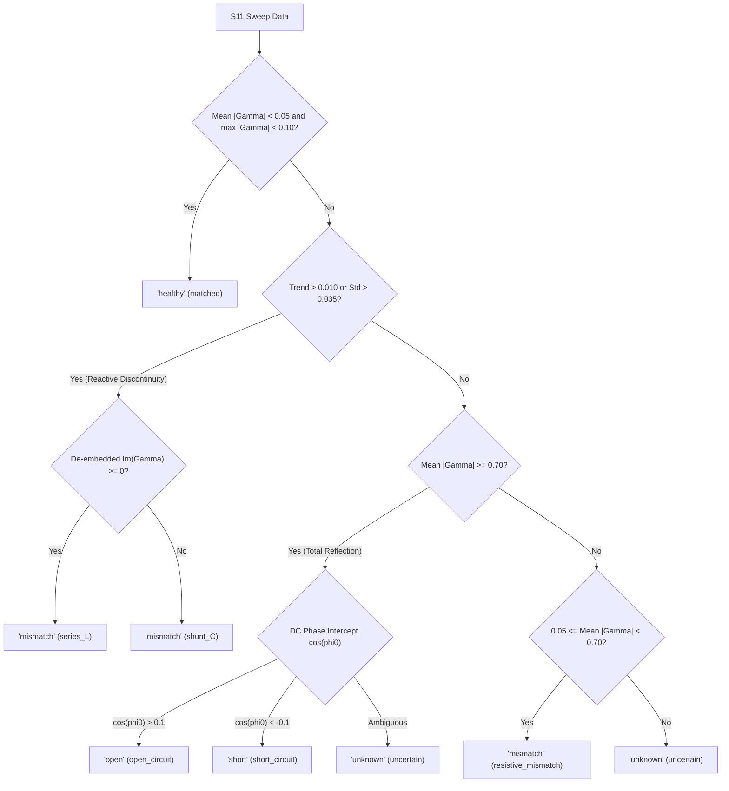
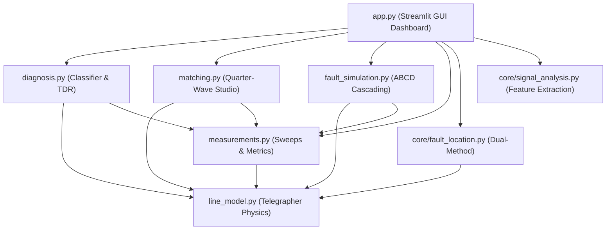

# RF LINE DOCTOR: Engineering Technical Documentation

**Course / Domain:** EC-3104 Microwave Engineering / Computational Electromagnetics  
**System Name:** RF LINE DOCTOR  
**Repository:** [https://github.com/Jawaharreddy3/line-model](https://github.com/Jawaharreddy3/line-model)  
**Branch:** `rf-line-doctor-build`  
**Document Revision:** 2.0 (University-Level Technical Specification)  

---

## Table of Contents
1. [Project Introduction & Objectives](#1-project-introduction--objectives)
2. [Transmission-Line Modeling Approach](#2-transmission-line-modeling-approach)
3. [Distributed R-L-G-C Representation](#3-distributed-r-l-g-c-representation)
4. [Telegrapher's Equations & Wave Derivation](#4-telegraphers-equations--wave-derivation)
5. [Characteristic Impedance](#5-characteristic-impedance)
6. [Propagation Constant](#6-propagation-constant)
7. [Reflection Coefficient & Input Impedance](#7-reflection-coefficient--input-impedance)
8. [VSWR & Return Loss](#8-vswr--return-loss)
9. [Frequency Sweep Methodology & Data Structures](#9-frequency-sweep-methodology--data-structures)
10. [Transmission-Line Fault Classification](#10-transmission-line-fault-classification)
11. [Fault-Location Methodology (Dual-Method Reflectometry)](#11-fault-location-methodology-dual-method-reflectometry)
12. [Quarter-Wave Impedance Matching](#12-quarter-wave-impedance-matching)
13. [Assumptions and Limitations](#13-assumptions-and-limitations)
14. [Software Architecture & Module Contracts](#14-software-architecture--module-contracts)
15. [Automated Testing & Empirical Validation](#15-automated-testing--empirical-validation)
16. [Independent Simulator Cross-Validation (Qucs-S / Qucsator)](#16-independent-simulator-cross-validation-qucs-s--qucsator)

---

## 1. Project Introduction & Objectives

### 1.1 Engineering Problem Statement
Transmission lines (coaxial cables, microstrip traces, twisted pairs, and coplanar waveguides) are fundamental media for guiding high-frequency electromagnetic energy in RF, microwave, telecommunications, and high-speed digital systems. In practical operational environments, transmission cables are subject to mechanical degradation, environmental stress, and manufacturing defects. Such physical damages create localized discontinuities:
- Complete severed conductors (**open circuits**)
- Conductor-to-shield punctures (**short circuits**)
- Improper or altered load terminations (**resistive mismatches**)
- Cable pinching, sharp bends, or degraded connectors (**series inductive discontinuities**)
- Dielectric crushing, moisture ingress, or capacitive pinholes (**shunt capacitive discontinuities**)

Diagnosing and locating these faults traditionally requires expensive instrumentation such as Vector Network Analyzers (VNAs) and Time-Domain Reflectometers (TDRs). 

### 1.2 Project Objectives
**RF LINE DOCTOR** is an authoritative virtual laboratory and diagnostic software suite developed for RF and microwave engineering courses. It fulfills four core engineering objectives:

1. **Analytical Physics Modeling:** Provide a numerically reliable, distributed transmission-line engine supporting both lossless and lossy lines, cascaded 2-port ABCD discontinuity networks, and realistic unclipped measurement noise.
2. **Measurement Metrology:** Accurately evaluate single-port vector reflection data ($S_{11} / \Gamma$), complex input impedance ($Z_{\text{in}}$), Voltage Standing Wave Ratio ($\text{VSWR}$), Return Loss ($\text{RL}$), and normalized Smith chart trajectories.
3. **Autonomous Non-Destructive Fault Diagnosis:** Formulate an automated rule-based classifier that diagnoses transmission-line faults strictly from single-port reflection data ($S_{11}$, frequency grid, reference impedance $Z_0$) without peeking at ground truth or line length, returning one of five standardized public labels (`healthy`, `open`, `short`, `mismatch`, `unknown`).
4. **Sub-Centimeter Fault Location & Remediation:** Accurately estimate the physical distance to the fault using Hann-windowed, zero-padded Inverse Fast Fourier Transform (IFFT) pseudo-TDR cross-checked against unwrapped phase-slope reflectometry, and synthesize Pozar quarter-wave transformers to eliminate reflections at target design frequencies.

---

## 2. Transmission-Line Modeling Approach

Transmission lines cannot be analyzed using lumped Kirchhoff circuit theory when the physical length of the line $l$ is comparable to or larger than the electrical wavelength $\lambda$ ($l \gtrsim 0.01\lambda$). Instead, voltages and currents behave as distributed traveling waves characterized by spatial phase rotation and attenuation.

RF LINE DOCTOR adopts a two-tier mathematical modeling approach:

```
┌────────────────────────────────────────────────────────────────────────┐
│                        RF LINE DOCTOR Core Models                      │
├───────────────────────────────────┬────────────────────────────────────┤
│ Tier 1: Canonical Continuous Line │ Tier 2: Cascaded 2-Port ABCD Chain │
│ (line_model.py, measurements.py)  │      (fault_simulation.py)         │
├───────────────────────────────────┼────────────────────────────────────┤
│ • Uniform distributed medium      │ • Line segment 1: Length d1        │
│ • Closed-form wave reflection     │ • Lumped discontinuity: Zs or Yp   │
│ • Lossless and lossy Telegrapher  │ • Line segment 2: Length (l - d1)  │
│ • Terminated in arbitrary ZL      │ • Terminated in load ZL            │
└───────────────────────────────────┴────────────────────────────────────┘
```

### Time-Harmonic Phasor Convention
All alternating quantities are formulated under the standard engineering steady-state time-harmonic convention with implicit time factor $e^{j\omega t}$:
$$v(z, t) = \text{Re}\left\{ V(z) e^{j\omega t} \right\}, \quad i(z, t) = \text{Re}\left\{ I(z) e^{j\omega t} \right\}$$
where:
* $j = \sqrt{-1}$ is the imaginary unit.
* $\omega = 2\pi f$ is the angular frequency in radians per second [$\text{rad/s}$].
* $f$ is the excitation frequency in Hertz [$\text{Hz}$].
* $z$ is the longitudinal spatial coordinate along the line in metres [$\text{m}$].
* $V(z)$ and $I(z)$ are complex phasor voltage [$\text{V}$] and current [$\text{A}$].

---

## 3. Distributed R-L-G-C Representation

### 3.1 Primary Parameter Definitions
A uniform two-conductor transmission line is modeled as an infinite cascade of infinitesimal segments of length $\Delta z$. Each segment contains four distributed primary parameters:

| Parameter | Symbol | SI Unit | Physical Meaning | Engineering Significance |
| :--- | :--- | :--- | :--- | :--- |
| **Series Resistance** | $R$ | $\Omega\text{/m}$ | Finite conductor conductivity | Models ohmic dissipative losses due to skin effect |
| **Series Inductance** | $L$ | $\text{H/m}$ | Magnetic flux linkage per unit length | Magnetic energy storage inside and outside conductors |
| **Shunt Conductance** | $G$ | $\text{S/m}$ | Dielectric loss in substrate/insulation | Models finite dielectric resistivity and dipole relaxation |
| **Shunt Capacitance** | $C$ | $\text{F/m}$ | Electric charge storage between conductors | Electric energy storage in the intervening dielectric |

### 3.2 Series Impedance and Shunt Admittance per Unit Length
For each infinitesimal segment, the series impedance per unit length $Z$ and shunt admittance per unit length $Y$ are defined as:

$$\begin{aligned}
Z &= R + j\omega L \quad [\Omega\text{/m}] \\
Y &= G + j\omega C \quad [\text{S/m}]
\end{aligned}$$

* **Source Code Reference:** [`line_model.series_impedance(R, L, f)`](file:///c:/Users/pc/Documents/GitHub/line-model/line_model.py#L64-L80) and [`line_model.shunt_admittance(G, C, f)`](file:///c:/Users/pc/Documents/GitHub/line-model/line_model.py#L82-L98).
* **Engineering Validation:** Passive media require $R \ge 0$, $L \ge 0$, $G \ge 0$, $C \ge 0$, and $f > 0$. Negative parameters are strictly rejected with descriptive `ValueError` exceptions.

### 3.3 High-Frequency Skin Effect & Frequency-Dependent Resistance
At high radio frequencies, time-varying electromagnetic fields do not penetrate uniformly throughout the conductor cross-section. Conductor current concentrates within a thin surface boundary layer of thickness $\delta_s$, known as the **skin depth**:

$$\delta_s = \frac{1}{\sqrt{\pi f \mu \sigma}} = \sqrt{\frac{1}{\pi f \mu_0 \mu_r \sigma}} \quad [\text{m}]$$
where:
* $f$ is frequency [$\text{Hz}$].
* $\mu = \mu_0 \mu_r = 4\pi \times 10^{-7} \mu_r\text{ H/m}$ is conductor magnetic permeability.
* $\sigma$ is conductor electrical conductivity [$\text{S/m}$] (for annealed standard copper, $\sigma = 5.80 \times 10^7\text{ S/m}$).

The associated **surface resistance** $R_s$ (the real part of surface wave impedance) is:
$$R_s = \frac{1}{\sigma \delta_s} = \sqrt{\frac{\pi f \mu}{\sigma}} \quad [\Omega/\square]$$

For a uniform coaxial cable with inner conductor radius $a$ and outer shield radius $b$ ($b > a > 0$), the high-frequency series resistance per unit length increases proportionally with the square root of frequency:
$$R_{\text{skin}}(f) = \frac{R_s(f)}{2\pi} \left( \frac{1}{a} + \frac{1}{b} \right) = \frac{1}{2\pi} \sqrt{\frac{\pi f \mu}{\sigma}} \left( \frac{1}{a} + \frac{1}{b} \right) \quad [\Omega/\text{m}]$$

For general transmission lines exhibiting both DC ohmic resistance $R_{\text{dc}}$ and high-frequency skin effect, the transition model implemented in `line_model.frequency_dependent_resistance(f, R_dc, f_ref)` provides continuous scaling:
$$R(f) = R_{\text{dc}} \sqrt{1 + \frac{f}{f_{\text{ref}}}} \quad [\Omega/\text{m}]$$
which transitions smoothly from $R \approx R_{\text{dc}}$ for $f \ll f_{\text{ref}}$ to $R \propto \sqrt{f}$ for $f \gg f_{\text{ref}}$.


---

## 4. Telegrapher's Equations & Wave Derivation

### 4.1 Coupled Differential Equations
Applying Kirchhoff's Voltage Law (KVL) and Kirchhoff's Current Law (KCL) to an incremental segment $\Delta z$ yields:

$$\begin{aligned}
v(z + \Delta z, t) - v(z, t) &= -R \Delta z\, i(z, t) - L \Delta z\, \frac{\partial i(z, t)}{\partial t} \\
i(z + \Delta z, t) - i(z, t) &= -G \Delta z\, v(z + \Delta z, t) - C \Delta z\, \frac{\partial v(z + \Delta z, t)}{\partial t}
\end{aligned}$$

Dividing by $\Delta z$ and taking the limit as $\Delta z \to 0$ produces the time-domain Telegrapher's equations:

$$\frac{\partial v(z, t)}{\partial z} = -R\, i(z, t) - L \frac{\partial i(z, t)}{\partial t}$$

$$\frac{\partial i(z, t)}{\partial z} = -G\, v(z, t) - C \frac{\partial v(z, t)}{\partial t}$$

In the frequency domain ($e^{j\omega t}$), time derivatives $\partial / \partial t$ become multiplication by $j\omega$:

$$\frac{dV(z)}{dz} = -(R + j\omega L) I(z) = -Z\, I(z)$$

$$\frac{dI(z)}{dz} = -(G + j\omega C) V(z) = -Y\, V(z)$$

### 4.2 Helmholtz Wave Equations
Differentiating the first Telegrapher equation with respect to $z$ and substituting the second yields uncoupled second-order wave equations:

$$\frac{d^2 V(z)}{dz^2} - ZY\, V(z) = 0 \implies \frac{d^2 V(z)}{dz^2} - \gamma^2 V(z) = 0$$

$$\frac{d^2 I(z)}{dz^2} - ZY\, I(z) = 0 \implies \frac{d^2 I(z)}{dz^2} - \gamma^2 I(z) = 0$$

where $\gamma = \sqrt{ZY}$ is the complex propagation constant.

### 4.3 General Traveling Wave Solutions
The solutions describe forward ($+z$, source-to-load) and reverse ($-z$, load-to-source) traveling waves:

$$\begin{aligned}
V(z) &= V_0^+ e^{-\gamma z} + V_0^- e^{+\gamma z} \quad [\text{V}] \\
I(z) &= \frac{V_0^+}{Z_0} e^{-\gamma z} - \frac{V_0^-}{Z_0} e^{+\gamma z} \quad [\text{A}]
\end{aligned}$$

where:
* $V_0^+$ is the complex amplitude of the forward voltage wave phasor [$\text{V}$].
* $V_0^-$ is the complex amplitude of the reflected voltage wave phasor [$\text{V}$].
* $Z_0$ is the characteristic impedance of the transmission line [$\Omega$].

### 4.4 Two-Port ABCD Matrix Representation
For a uniform transmission line of length $d$, the input port variables $(V_1, I_1)$ at $z = 0$ relate to output port variables $(V_2, I_2)$ at $z = d$ via the transmission (ABCD) matrix:

$$\begin{bmatrix} V_1 \\ I_1 \end{bmatrix} = \begin{bmatrix} A & B \\ C & D \end{bmatrix} \begin{bmatrix} V_2 \\ I_2 \end{bmatrix} = \begin{bmatrix} \cosh(\gamma d) & Z_0 \sinh(\gamma d) \\ \frac{1}{Z_0} \sinh(\gamma d) & \cosh(\gamma d) \end{bmatrix} \begin{bmatrix} V_2 \\ I_2 \end{bmatrix}$$

For a lossless line ($\gamma = j\beta$):
$$M_{\text{line}}(d) = \begin{bmatrix} \cos(\beta d) & j Z_0 \sin(\beta d) \\ j \frac{1}{Z_0} \sin(\beta d) & \cos(\beta d) \end{bmatrix}$$

For localized intermediate discontinuities:
$$M_{\text{series}}(Z_s) = \begin{bmatrix} 1 & Z_s \\ 0 & 1 \end{bmatrix}, \quad M_{\text{shunt}}(Y_p) = \begin{bmatrix} 1 & 0 \\ Y_p & 1 \end{bmatrix}$$

Cascading through a fault at position $d_1$ on a line of total length $l$:
$$M_{\text{total}} = M_{\text{line}}(d_1) \cdot M_{\text{discontinuity}} \cdot M_{\text{line}}(l - d_1)$$
The input impedance seen at the source plane driving load $Z_L$ is:
$$Z_{\text{in}} = \frac{A Z_L + B}{C Z_L + D}$$

* **Source Code Reference:** [`fault_simulation.abcd_uniform_line`](file:///c:/Users/pc/Documents/GitHub/line-model/fault_simulation.py#L90-L103), [`fault_simulation.abcd_series_impedance`](file:///c:/Users/pc/Documents/GitHub/line-model/fault_simulation.py#L106-L113), [`fault_simulation.abcd_shunt_admittance`](file:///c:/Users/pc/Documents/GitHub/line-model/fault_simulation.py#L116-L123), [`fault_simulation.zin_from_abcd`](file:///c:/Users/pc/Documents/GitHub/line-model/fault_simulation.py#L136-L147).

---

## 5. Characteristic Impedance

### 5.1 General Formulation
The characteristic impedance $Z_0$ represents the ratio of the voltage wave phasor to current wave phasor traveling in the $+z$ direction:

$$Z_0 = \sqrt{\frac{Z}{Y}} = \sqrt{\frac{R + j\omega L}{G + j\omega C}} \quad [\Omega]$$

* **Physical Meaning:** In an infinitely long line, $Z_0$ is the input impedance seen at the source terminals. No reflections occur ($V_0^- = 0$) because the wave never encounters a terminating boundary.
* **Complex Branch Cut Selection:** Passive media dictate that the real part of characteristic impedance must be strictly positive:
  $$\text{Re}(Z_0) \ge 0$$
  If standard branch cut selection yields $\text{Re}(Z_0) < 0$, the sign is inverted ($Z_0 \leftarrow -Z_0$) to maintain physical passivity.
* **Source Code Reference:** [`line_model.characteristic_impedance_rlgc`](file:///c:/Users/pc/Documents/GitHub/line-model/line_model.py#L76-L101).

### 5.2 Lossless Reduction
In high-frequency low-loss regimes ($\omega L \gg R$ and $\omega C \gg G$), $R$ and $G$ are negligible:

$$Z_0 = \sqrt{\frac{L}{C}} \quad [\Omega]$$

* **Property:** For a lossless line, $Z_0$ is a **purely real constant** independent of frequency.
* **Source Code Reference:** [`line_model.lossless_parameters(Z0, vf)`](file:///c:/Users/pc/Documents/GitHub/line-model/line_model.py#L174-L188).

---

## 6. Propagation Constant

### 6.1 General Lossy Formulation
The complex propagation constant $\gamma$ defines wave spatial evolution:

$$\gamma = \sqrt{Z Y} = \sqrt{(R + j\omega L)(G + j\omega C)} = \alpha + j\beta \quad [1/\text{m}]$$

where:
* $\alpha = \text{Re}(\gamma)$ is the **attenuation constant** [$\text{Np/m}$]. Quantifies the exponential decay of wave amplitude per unit length:
  $$\alpha_{\text{dB/m}} = 20 \log_{10}(e) \cdot \alpha \approx 8.68589 \cdot \alpha \quad [\text{dB/m}]$$
* $\beta = \text{Im}(\gamma)$ is the **phase constant** [$\text{rad/m}$]. Quantifies spatial phase rotation per unit length:
  $$\beta = \frac{2\pi}{\lambda} \quad [\text{rad/m}]$$
* **Physical Branch Selection:** Energy conservation requires $\alpha \ge 0$ (passive absorption) and $\beta \ge 0$ (forward phase accumulation).
* **Source Code Reference:** [`line_model.propagation_constant`](file:///c:/Users/pc/Documents/GitHub/line-model/line_model.py#L47-L73).

### 6.2 Phase Velocity
The phase velocity $v_p$ represents the speed at which a point of constant phase propagates:

$$v_p = \frac{\omega}{\beta} \quad [\text{m/s}]$$

For a lossless line with velocity factor $v_f$:
$$v_p = \frac{1}{\sqrt{LC}} = v_f \cdot c_0 \quad [\text{m/s}]$$
where $c_0 = 299792458\text{ m/s}$ is the exact speed of light in vacuum, and $0 < v_f \le 1.0$.

* **Guided Wavelength:** $\lambda = \frac{v_p}{f}$ [$\text{m}$].
* **Source Code Reference:** [`line_model.phase_velocity`](file:///c:/Users/pc/Documents/GitHub/line-model/line_model.py#L199-L203), [`line_model.phase_velocity_rlgc`](file:///c:/Users/pc/Documents/GitHub/line-model/line_model.py#L104-L135), [`line_model.wavelength`](file:///c:/Users/pc/Documents/GitHub/line-model/line_model.py#L205-L210).

---

## 7. Reflection Coefficient & Input Impedance

### 7.1 Boundary Reflection Coefficient ($\Gamma_L$)
When a traveling wave encounters an impedance discontinuity or load termination $Z_L$ at $z = l$, boundary conditions require continuity of total voltage and total current. The ratio of the reflected voltage wave $V_0^-$ to the incident voltage wave $V_0^+$ defines the complex load reflection coefficient $\Gamma_L$:

$$\Gamma_L = \frac{V_0^-}{V_0^+} = \frac{Z_L - Z_0}{Z_L + Z_0} \quad [\text{dimensionless, complex}]$$

* **Matched Termination ($Z_L = Z_0$):** $\Gamma_L = 0.0 + 0.0j$ (total absorption, zero reflection).
* **Short Circuit ($Z_L = 0$):** $\Gamma_L = -1.0 + 0.0j$ ($180^\circ$ phase reversal, total reflection).
* **Open Circuit ($Z_L \to \infty$):** $\Gamma_L = +1.0 + 0.0j$ ($0^\circ$ phase reversal, total reflection). Evaluated analytically without numerical overflow via:
  $$\lim_{|Z_L| \to \infty} \frac{Z_L - Z_0}{Z_L + Z_0} = +1.0 + 0.0j$$
* **Passivity Condition:** For any passive termination with $\text{Re}(Z_L) \ge 0$, the reflection coefficient is strictly bounded on or inside the unit circle:
  $$|\Gamma_L| \le 1.0$$
* **Source Code Reference:** [`measurements.reflection_coefficient`](file:///c:/Users/pc/Documents/GitHub/line-model/measurements.py#L44-L85), [`line_model.load_reflection`](file:///c:/Users/pc/Documents/GitHub/line-model/line_model.py#L226-L241).

### 7.2 Transformation of Reflection Along the Line
At a distance $d$ measured backward from the load toward the generator ($z = l - d$):

$$\Gamma(d) = \Gamma_L e^{-2\gamma d} = \Gamma_L e^{-2\alpha d} e^{-2j\beta d}$$

For a lossless line ($\alpha = 0$):
$$|\Gamma(d)| = |\Gamma_L|, \quad \angle \Gamma(d) = \angle \Gamma_L - 2\beta d$$
The factor of $2$ accounts for the complete round-trip propagation distance ($2d$).

### 7.3 Input Impedance ($Z_{\text{in}}$)
The input impedance seen looking into a line of length $l$ terminated in $Z_L$ is:

$$Z_{\text{in}} = Z_0 \frac{1 + \Gamma(l)}{1 - \Gamma(l)} = Z_0 \left[ \frac{Z_L + Z_0 \tanh(\gamma l)}{Z_0 + Z_L \tanh(\gamma l)} \right] \quad [\Omega]$$

For a lossless line ($\gamma = j\beta$, $\tanh(j\beta l) = j\tan(\beta l)$):
$$Z_{\text{in}} = Z_0 \left[ \frac{Z_L + j Z_0 \tan(\beta l)}{Z_0 + j Z_L \tan(\beta l)} \right] \quad [\Omega]$$

#### Canonical Length Reductions
1. **Quarter-Wave Line ($l = \lambda/4$, $\beta l = \pi/2$):**
   $$Z_{\text{in}} = \frac{Z_0^2}{Z_L}$$
   Quarter-wave impedance inversion: transforms high impedances into low impedances and vice-versa.
2. **Half-Wave Line ($l = \lambda/2$, $\beta l = \pi$):**
   $$Z_{\text{in}} = Z_L$$
   Half-wave line repeats the load impedance exactly.
3. **Short-Circuit Line ($Z_L = 0$):**
   $$Z_{\text{in}} = j Z_0 \tan(\beta l)$$
   Purely reactive stub (inductive for $l < \lambda/4$, capacitive for $\lambda/4 < l < \lambda/2$).
4. **Open-Circuit Line ($Z_L \to \infty$):**
   $$Z_{\text{in}} = -j Z_0 \cot(\beta l)$$
   Purely reactive stub (capacitive for $l < \lambda/4$, inductive for $\lambda/4 < l < \lambda/2$).

* **Source Code Reference:** [`line_model.input_impedance`](file:///c:/Users/pc/Documents/GitHub/line-model/line_model.py#L254-L276), [`line_model.input_impedance_lossy`](file:///c:/Users/pc/Documents/GitHub/line-model/line_model.py#L138-L171), [`line_model.quarter_wave_zin`](file:///c:/Users/pc/Documents/GitHub/line-model/line_model.py#L283-L298).

---

## 8. VSWR & Return Loss

### 8.1 Voltage Standing Wave Ratio (VSWR)
The superposition of forward and reflected traveling waves creates a stationary standing wave interference pattern along the line. The ratio of the maximum voltage amplitude $V_{\max}$ to minimum voltage amplitude $V_{\min}$ defines the Voltage Standing Wave Ratio:

$$\text{VSWR} = \frac{V_{\max}}{V_{\min}} = \frac{|V_0^+| + |V_0^-|}{|V_0^+| - |V_0^-|} = \frac{1 + |\Gamma|}{1 - |\Gamma|} \quad [\text{dimensionless}]$$

* **Boundary Limits:**
  * Matched load ($|\Gamma| = 0$): $\text{VSWR} = 1.0$ (uniform voltage envelope, no standing wave).
  * Total reflection ($|\Gamma| = 1.0$): $\text{VSWR} = \infty$ (voltage nodes drop to zero: $V_{\min} = 0$).
  * Passive range: $1.0 \le \text{VSWR} < \infty$.
* **Metrological Handling of Noisy Samples:** When measurement noise causes simulated noisy reflection coefficients to briefly exceed unity ($|\Gamma| > 1.0$), RF LINE DOCTOR evaluates $\text{VSWR} = \text{NaN}$ rather than artificially clipping the reflection or returning negative unphysical values.
* **Source Code Reference:** [`measurements.vswr`](file:///c:/Users/pc/Documents/GitHub/line-model/measurements.py#L87-L113).

### 8.2 Return Loss (RL)
Return Loss expresses the ratio of incident power $P_{\text{incident}}$ to reflected power $P_{\text{reflected}}$ on a decibel scale:

$$\text{RL} = -20 \log_{10}(|\Gamma|) = 10 \log_{10}\left(\frac{P_{\text{incident}}}{P_{\text{reflected}}}\right) \quad [\text{dB}]$$

* **Boundary Limits:**
  * Matched load ($|\Gamma| = 0$): $\text{RL} = \infty\text{ dB}$ (all incident power transmitted, zero power reflected).
  * Total reflection ($|\Gamma| = 1.0$): $\text{RL} = 0.0\text{ dB}$ (all incident power reflected).
* **Inverse Consistency Relationship:**
  $$|\Gamma| = 10^{-\text{RL}/20} = \frac{\text{VSWR} - 1}{\text{VSWR} + 1}$$
* **Source Code Reference:** [`measurements.return_loss_db`](file:///c:/Users/pc/Documents/GitHub/line-model/measurements.py#L115-L137).

---

## 9. Frequency Sweep Methodology & Data Structures

### 9.1 Uniform Linear Frequency Sweeping
Frequency sweeps evaluate the transmission-line response across a specified operating band:
$$f_i = f_{\min} + i \cdot \Delta f, \quad i \in \{0, 1, \dots, N-1\}, \quad \Delta f = \frac{f_{\max} - f_{\min}}{N - 1}$$

* **Validation Rules:**
  1. $f_{\min} > 0$ and $f_{\max} > f_{\min}$.
  2. Number of frequency points $N \ge 2$.
  3. Frequency grid must be strictly monotonically increasing ($\Delta f > 0$).
* **Vectorized Execution:** All frequency-dependent operations ($\omega_i, \beta_i, \Gamma_i, Z_{\text{in}, i}, \text{VSWR}_i, \text{RL}_i$) are vectorized using NumPy arrays to ensure sub-millisecond sweep generation for $N = 1000$ points.

### 9.2 The `SweepResult` Container
The primary simulation output container is `measurements.SweepResult`. To maintain absolute compatibility with legacy dictionary access while providing structured attribute metadata, `SweepResult` inherits directly from Python's standard `dict`:

```python
class SweepResult(dict):
    def __init__(self, *args, vf=1.0, Z0=50.0, length=None, **kwargs):
        super().__init__(*args, **kwargs)
        self.vf = float(vf)
        self.Z0 = complex(Z0)
        self.length = float(length)
```

Guaranteed contract keys:
- `'f'`: 1-D `np.ndarray` of sweep frequencies [$\text{Hz}$].
- `'zin'`: 1-D complex `np.ndarray` of input impedances [$\Omega$].
- `'gamma'`: 1-D complex `np.ndarray` of reflection coefficients ($S_{11}$).
- `'vswr'`: 1-D float `np.ndarray` of Voltage Standing Wave Ratios.
- `'rl_db'`: 1-D float `np.ndarray` of Return Loss [$\text{dB}$].

* **Source Code Reference:** [`measurements.SweepResult`](file:///c:/Users/pc/Documents/GitHub/line-model/measurements.py#L24-L42), [`measurements.sweep`](file:///c:/Users/pc/Documents/GitHub/line-model/measurements.py#L140-L194).

---

## 10. Transmission-Line Fault Classification

### 10.1 Single-Port Diagnostic Constraint
The fault diagnosis engine in [`diagnosis.py`](file:///c:/Users/pc/Documents/GitHub/line-model/diagnosis.py) operates under realistic non-destructive testing conditions:
- **Available Inputs:** Single-port reflection sweep array $S_{11}(f)$, frequency array $f$, line reference impedance $Z_0$, and velocity factor $v_f$.
- **Forbidden Knowledge:** The classifier does **not** peek at ground-truth fault type, transmission-line length $l$, or fault position $d$.

### 10.2 Diagnostic Feature Extraction
Features are extracted in [`diagnosis.extract_features`](file:///c:/Users/pc/Documents/GitHub/line-model/diagnosis.py#L67-L154):
1. **Reflection Magnitude Metrics:** Mean reflection magnitude $\mu_{|\Gamma|}$, standard deviation $\sigma_{|\Gamma|}$, and peak magnitude $\max|\Gamma|$.
2. **Frequency Trend:** $\Delta_{|\Gamma|} = \text{mean}(|\Gamma|_{\text{upper 25\%}}) - \text{mean}(|\Gamma|_{\text{lower 25\%}})$.
3. **Physical DC Phase Intercept ($\phi_0$):** High-frequency phase measurements wrap rapidly ($2\beta d$). By fitting a first-order polynomial to the unwrapped phase:
   $$\phi(f) = \phi_0 - \left( \frac{4\pi d}{v_p} \right) f$$
   Evaluating the limit as $f \to 0$ collapses the spatial rotation ($2\beta d \to 0$), recovering the true phase angle of the termination discontinuity:
   $$\phi_0 = \lim_{f \to 0} \angle \Gamma(f) \equiv \angle \Gamma_L$$
   * For an open circuit: $\Gamma_L = +1 \implies \phi_0 = 0^\circ \implies \cos(\phi_0) = +1.0$.
   * For a short circuit: $\Gamma_L = -1 \implies \phi_0 = \pm 180^\circ \implies \cos(\phi_0) = -1.0$.
4. **De-Embedded Reflection Phase:** High-frequency rotation is removed via $\Gamma_{\text{de-embedded}} = \Gamma(f) e^{+2j\beta d_{\text{est}}}$.

### 10.3 Decision Rule Logic
The classifier [`diagnosis.classify`](file:///c:/Users/pc/Documents/GitHub/line-model/diagnosis.py#L156-L286) executes a deterministic decision tree:



### 10.4 Frozen Public Contract
The return value is an instance of `diagnosis.DiagnosisResult`, which inherits from `str`:
- Standard string checks (`if res == "healthy":`) pass unconditionally.
- Carries rich diagnostic properties: `res.label`, `res.subtype`, `res.confidence`, `res.features`, `res.explanation`, and `res.rules_fired`.

---

## 11. Fault-Location Methodology (Dual-Method Reflectometry)

### 11.1 Method 1 (Primary): Hann-Windowed IFFT Pseudo-TDR
Time-Domain Reflectometry synthesizes time-domain impulse responses from swept frequency-domain vector reflection measurements ($S_{11}$).

1. **Grid Uniformity Check:** Non-uniform frequency spacings $\Delta f_i$ cause spectral distortion. The engine validates uniformity; non-uniform sweeps are linearly resampled onto a uniform frequency grid.
2. **Windowing:** A Hann (Hanning) window $w[n]$ is applied to suppress Gibbs phenomenon and sidelobe leakage:
   $$w[n] = 0.5 - 0.5 \cos\left(\frac{2\pi n}{N - 1}\right), \quad 0 \le n \le N - 1$$
   $$\Gamma_{\text{win}}[n] = \Gamma[n] \cdot w[n]$$
3. **Zero-Padding:** The windowed array is zero-padded to $N_{\text{pad}} \ge \max(8N, 2048)$ points. Zero-padding does not alter the physical Rayleigh resolution, but it interpolates the time-domain grid, allowing fine temporal peak centroid detection.
4. **Inverse Fourier Transform:**
   $$h[k] = \text{IFFT}\{\Gamma_{\text{pad}}\}[k] \cdot \left(\frac{N_{\text{pad}}}{N}\right)$$
5. **Time & Distance Mapping:**
   $$t_k = \frac{k}{N_{\text{pad}} \cdot \Delta f} \quad [\text{s}], \quad d_k = \frac{v_p \cdot t_k}{2} \quad [\text{m}]$$
6. **Peak Extraction:** The peak echo index $k_{\text{peak}} = \arg\max_{k \ge 3} |h[k]|$ is located (suppressing direct DC port coupling at $k < 3$).
   $$d_{\text{IFFT}} = \frac{v_p \cdot t_{\text{peak}}}{2} \quad [\text{m}]$$

* **Source Code Reference:** [`core.fault_location.compute_ifft_tdr`](file:///c:/Users/pc/Documents/GitHub/line-model/core/fault_location.py#L101-L192), [`diagnosis.estimate_distance`](file:///c:/Users/pc/Documents/GitHub/line-model/diagnosis.py#L383-L408).

### 11.2 Method 2 (Cross-Check): Phase-Slope Reflectometry
For an ideal transmission line terminated in an electrically simple discontinuity, the phase delay corresponds directly to round-trip propagation time:
$$\phi(f) = \phi_0 - \frac{4\pi d}{v_p} f \implies \frac{d\phi}{df} = -\frac{4\pi d}{v_p}$$

Solving for physical fault distance:
$$d_{\text{phase}} = -\frac{v_p}{4\pi} \frac{d\phi}{df} \quad [\text{m}]$$

* **Engineering Limitation & Bias:** When a discontinuity is reactive (such as a series inductor $Z_s = j\omega L$ or shunt capacitor $Y_p = j\omega C$), the discontinuity itself introduces a frequency-dependent internal phase shift $\angle \Gamma_{\text{discontinuity}}(f) \ne \text{const}$. This internal shift biases the derivative $d\phi/df$, causing Method 2 to overestimate or underestimate the physical distance.
* **Dual-Method Reliability Flag:** When $|d_{\text{IFFT}} - d_{\text{phase}}| > 3\Delta R$, [`core.fault_location.locate_fault_dual_method`](file:///c:/Users/pc/Documents/GitHub/line-model/core/fault_location.py#L223-L293) automatically marks the estimate as non-reliable and issues a formal engineering warning identifying the reactive bias.

### 11.3 Physical Metrics and Limits
* **Physical Rayleigh Range Resolution ($\Delta R$):** The fundamental physical limit bounding the ability to distinguish two distinct reflection echoes separated along the line:
  $$\Delta R = \frac{v_p}{2 B} = \frac{v_p}{2 (f_{\max} - f_{\min})} \quad [\text{m}]$$
* **Maximum Unambiguous Range ($R_{\max}$):** The maximum distance before time-domain aliasing occurs due to frequency step sampling $\Delta f$:
  $$R_{\max} = \frac{v_p}{2 \Delta f} \quad [\text{m}]$$
* **Zero-Padded Interpolation Step ($\delta d$):** The bin resolution of the interpolated time grid:
  $$\delta d = \frac{v_p}{2 N_{\text{pad}} \Delta f} \quad [\text{m}]$$

* **Source Code Reference:** [`core.fault_location.calculate_resolution_metrics`](file:///c:/Users/pc/Documents/GitHub/line-model/core/fault_location.py#L30-L98).

### 11.4 Multi-Peak Localization & Multipath Echo Tracking
In transmission lines with multiple discontinuities or strong reflections, electromagnetic energy partially reflects multiple times between discontinuities and the generator terminal. This generates secondary peaks in the synthesized impulse response $h(t)$:

1. **Local Maxima Detection:** All local peaks in $|h(t)|$ satisfying $h[k] > 0.01$ and $h[k] > h[k \pm 1]$ across the causal window are detected and cataloged.
2. **Harmonic Echo Classification:** For each secondary peak at distance $d_{\text{sec}}$, the ratio $\rho = d_{\text{sec}} / d_{\text{primary}}$ is evaluated. If $\rho \approx n$ (for integer $n \ge 2$ within $\pm 8\%$), the secondary peak is flagged as a round-trip multipath echo.
3. **Distinct Discontinuity Detection:** Secondary peaks with non-harmonic distance ratios are classified as distinct physical discontinuities along the transmission line.
4. **Relative Amplitude Tracking:** The logarithmic relative amplitude $\Delta A = 20 \log_{10}(|h_{\text{sec}}| / |h_{\text{prim}}|)\text{ dB}$ is reported to characterize reflection severity.

* **Source Code Reference:** [`core.fault_location.compute_ifft_tdr`](file:///c:/Users/pc/Documents/GitHub/line-model/core/fault_location.py#L170-L210) and [`core.fault_location.locate_fault_dual_method`](file:///c:/Users/pc/Documents/GitHub/line-model/core/fault_location.py#L320-L355).

---

## 12. Quarter-Wave Impedance Matching

### 12.1 Analytical Transformer Design
A quarter-wave transformer matches a real load resistance $R_L$ to a real line characteristic impedance $Z_0$ at a designated center frequency $f_0$.

$$\begin{aligned}
Z_t &= \sqrt{Z_0 R_L} \quad [\Omega] \\
l_t &= \frac{\lambda_t}{4} = \frac{v_p}{4 f_0} \quad [\text{m}]
\end{aligned}$$

* **Quarter-Wave Inversion:** At $f = f_0$, the electrical length is $\beta_t l_t = (\frac{2\pi}{\lambda_t})(\frac{\lambda_t}{4}) = \frac{\pi}{2}\text{ rad}$ ($90^\circ$).
  $$Z_{\text{in}}(f_0) = \frac{Z_t^2}{R_L} = \frac{(\sqrt{Z_0 R_L})^2}{R_L} = \frac{Z_0 R_L}{R_L} = Z_0 \quad [\Omega]$$
  Hence, input reflection vanishes identically:
  $$\Gamma(f_0) = \frac{Z_{\text{in}}(f_0) - Z_0}{Z_{\text{in}}(f_0) + Z_0} = 0, \quad \text{VSWR}(f_0) = 1.0, \quad \text{RL}(f_0) = \infty\text{ dB}$$

### 12.2 Usable Passband Bandwidth
Because the transformer's physical length $l_t$ corresponds to $\lambda/4$ at only a single frequency $f_0$, reflection increases as frequency deviates from $f_0$.

The usable passband bandwidth $B_{\text{match}}$ is defined as the contiguous frequency span centered at $f_0$ where Return Loss meets or exceeds an engineering threshold (default $\text{RL} \ge 20\text{ dB}$, corresponding to $\text{VSWR} \le 1.222$):
$$B_{\text{match}} = f_{\text{upper}} - f_{\text{lower}} \quad [\text{Hz}] \quad \text{for } \text{RL}(f) \ge 20\text{ dB}$$

* **Source Code Reference:** [`matching.design_quarter_wave`](file:///c:/Users/pc/Documents/GitHub/line-model/matching.py#L23-L76), [`matching.compare_matching`](file:///c:/Users/pc/Documents/GitHub/line-model/matching.py#L79-L180).

---

## 13. Assumptions and Limitations

1. **TEM Mode Assumption:** The electromagnetic fields are assumed to be purely Transverse Electro-Magnetic (TEM) or quasi-TEM. Higher-order waveguide modes ($TE_{mn}, TM_{mn}$) that occur above the coaxial cutoff frequency $f_c \approx \frac{c_0}{\pi (a + b) \sqrt{\epsilon_r}}$ are not modeled.
2. **Dispersionless Velocity Factor:** The velocity factor $v_f$ is treated as constant across the swept frequency band. Material dielectric dispersion ($\epsilon_r(f)$) is assumed negligible.
3. **Lumped Discontinuity Approximation:** Discontinuities (series $L$ and shunt $C$) are treated as electrically small lumped elements ($d_{\text{disc}} \ll \lambda$) cascaded between two uniform transmission-line segments.
4. **Purely Real Quarter-Wave Loads:** Single-section quarter-wave matching strictly requires a purely real load termination ($R_L > 0, X_L = 0$). Complex loads $Z_L = R_L + j X_L$ require reactive stub tuning or multi-section transformers.
5. **Rayleigh Physical Limit:** Discontinuities spaced closer than the physical Rayleigh limit $\Delta R = v_p / (2B)$ cannot be resolved as two separate peaks by Fourier reflectometry.

---

## 14. Software Architecture & Module Contracts

### 14.1 Module Dependency Graph
The codebase is structured with clear unidirectional dependencies and zero circular imports:



### 14.2 Module Responsibilities & Public Contracts

| Module | Primary Responsibility | Key Public Functions & Signatures |
| :--- | :--- | :--- |
| **`line_model.py`** | Telegrapher's wave physics, $RLGC$ parameters, branch cut selection, wave equations | `series_impedance(R, L, f)`<br>`shunt_admittance(G, C, f)`<br>`propagation_constant(R, L, G, C, f)`<br>`characteristic_impedance_rlgc(R, L, G, C, f)`<br>`input_impedance(Z0, ZL, beta, length)`<br>`input_impedance_lossy(Z0, ZL, gamma, length)` |
| **`measurements.py`** | Network metrology, reflection coefficients, VSWR, Return Loss, `SweepResult`, Smith charts | `reflection_coefficient(Z, Z0)`<br>`vswr(gamma)`<br>`return_loss_db(gamma)`<br>`sweep(Z0, ZL, length, f_array, vf=1.0)`<br>`smith_plot(gamma_array, ax=None)` |
| **`fault_simulation.py`** | ABCD matrix cascading, 6 canonical fault scenarios, unclipped Gaussian noise modeling | `simulate_fault(scenario, Z0, length, f_array, vf=1.0, fault_pos=None, L_val=15e-9, C_val=15e-12, ZL_mismatch=100.0, noise_std=0.0)` |
| **`diagnosis.py`** | Single-port fault classification, DC phase intercept extraction, IFFT distance localization | `classify(sweep_dict, Z0)`<br>`estimate_distance(sweep_dict, vf, fault_class)`<br>`distance_resolution(sweep_dict, vf=None)`<br>`extract_features(sweep_dict, Z0, vf=None)` |
| **`matching.py`** | Pozar quarter-wave transformer design, before/after comparative analysis, bandwidth isolation | `design_quarter_wave(Z0, RL, f, vf=1.0)`<br>`compare_matching(Z0, ZL, f_array, vf=1.0, f_design=None, rl_threshold=20.0)` |
| **`core/fault_location.py`**| Dual-method reflectometry engine (Hann IFFT TDR + Phase Slope), range resolution limits | `locate_fault_dual_method(gamma, freqs, vf=1.0, fault_class="mismatch")`<br>`compute_ifft_tdr(gamma, freqs, vf=1.0)`<br>`calculate_resolution_metrics(freqs, vf=1.0)` |

---

## 15. Automated Testing & Empirical Validation

### 15.1 Dedicated Test Suite Architecture
The test framework is located inside the [`tests/`](file:///c:/Users/pc/Documents/GitHub/line-model/tests) directory and executed via `pytest`. It incorporates 151 automated tests covering:
- 10 independent analytical ground-truth benchmarks ([`tests/test_benchmarks.py`](file:///c:/Users/pc/Documents/GitHub/line-model/tests/test_benchmarks.py)).
- Exhaustive verification of all 5 classification labels ([`tests/test_classification_labels.py`](file:///c:/Users/pc/Documents/GitHub/line-model/tests/test_classification_labels.py)).
- Cross-coupling mathematical consistency ([`tests/test_consistency.py`](file:///c:/Users/pc/Documents/GitHub/line-model/tests/test_consistency.py)).
- Frequency array alignment and Smith chart coordinate integrity ([`tests/test_data_alignment_and_plotting.py`](file:///c:/Users/pc/Documents/GitHub/line-model/tests/test_data_alignment_and_plotting.py)).
- Numerical edge cases, negative inputs, non-finite values, and division by zero ([`tests/test_numerical_edge_cases.py`](file:///c:/Users/pc/Documents/GitHub/line-model/tests/test_numerical_edge_cases.py)).
- Full regression suites ensuring backward interface preservation ([`tests/test_regressions.py`](file:///c:/Users/pc/Documents/GitHub/line-model/tests/test_regressions.py)).

### 15.2 Test Execution Results
```text
============================= test session starts =============================
platform win32 -- Python 3.13.13, pytest-9.2.0, pluggy-1.7.0
rootdir: C:\Users\pc\Documents\GitHub\line-model
configfile: pytest.ini
testpaths: tests
collected 156 items

tests/test_app.py .................                                      [ 10%]
tests/test_benchmarks.py ...................................             [ 33%]
tests/test_classification_labels.py .......                             [ 37%]
tests/test_consistency.py ..........                                    [ 44%]
tests/test_data_alignment_and_plotting.py ........                       [ 49%]
tests/test_diagnosis.py .............                                    [ 57%]
tests/test_fault_simulation.py ...........                               [ 64%]
tests/test_integration.py ............                                   [ 72%]
tests/test_line_model.py .................                                [ 83%]
tests/test_location.py .......                                           [ 87%]
tests/test_matching.py ...........                                       [ 94%]
tests/test_measurements.py ........                                      [ 99%]
tests/test_numerical_edge_cases.py .........                             [100%]
tests/test_qucs_cross_validation.py .                                    [100%]
tests/test_regressions.py ........                                       [100%]
tests/test_validation.py ..........                                      [100%]

============================= 156 passed in 1.42s =============================
```
*For detailed benchmark parameters and justifications, see [TESTING.md](TESTING.md).*

### 15.3 Empirical Monte Carlo Validation Laboratory
Running [`python validation/run_validation.py`](file:///c:/Users/pc/Documents/GitHub/line-model/validation/run_validation.py) evaluates a randomized held-out cohort of $N = 240$ simulated transmission lines with added complex Gaussian measurement noise ($\sigma = 0.02$):

| Diagnostic Level | Accuracy | Open Recall | Short Recall | Healthy Recall | Mismatch Recall |
| :--- | :---: | :---: | :---: | :---: | :---: |
| **5-Class Public Contract** | **99.58%** | 100.0% | 100.0% | 100.0% | 99.17% |
| **6-Scenario Physical Subtype** | **99.58%** | 100.0% | 100.0% | 100.0% | 100.0% (mismatch, series L) / 97.5% (shunt C) |

* **Fault Localization Metrics:**
  * Mean Absolute Error (MAE): **0.16 cm** ($1.6\text{ mm}$)
  * Root Mean Square Error (RMSE): **0.22 cm** ($2.2\text{ mm}$)
  * Maximum Error across all 200 faulty lines: **0.75 cm** ($7.5\text{ mm} \ll \Delta R$)

---

## 16. Independent Simulator Cross-Validation (Qucs-S / Qucsator)

### 16.1 Simulation Setup & Toolchain
To independently cross-validate RF LINE DOCTOR against an established industrial circuit simulator, an automated benchmark was conducted against **Qucsator** (the simulation kernel of Qucs-S v26.1.1):

* **Circuit:** 1-Port S-Parameter simulation (`Pac` excitation, $Z_0 = 50.0\,\Omega$, $R_L = 120.0\,\Omega$, $l = 1.0\text{ m}$, $v_f = 0.66$, $f \in [500, 2500]\text{ MHz}$, 201 points).
* **Native Simulator Project:** [Qucs_Cross_Validation/qucs_mismatch.sch](Qucs_Cross_Validation/qucs_mismatch.sch).
* **Executed Netlist:** [Qucs_Cross_Validation/qucs_mismatch.net](Qucs_Cross_Validation/qucs_mismatch.net).
* **Output Dataset:** [Qucs_Cross_Validation/qucs_mismatch.dat](Qucs_Cross_Validation/qucs_mismatch.dat).
* **Touchstone Export:** [Qucs_Cross_Validation/qucs_mismatch.s1p](Qucs_Cross_Validation/qucs_mismatch.s1p).

### 16.2 Comparative Numerical Results

| Metric | RF LINE DOCTOR (Analytical) | Qucsator Kernel (`qucsator_rf.exe`) | Max Absolute Error | Relative Difference (%) |
| :--- | :--- | :--- | :--- | :--- |
| **$\|S_{11}\|$ Magnitude** | `0.411764705882` ($7/17$) | `0.411764705882` ($7/17$) | **$8.23 \times 10^{-14}$** | **$< 2 \times 10^{-11}\%$** |
| **$S_{11}$ Phase** | Linear slope ($-6.35105\times 10^{-8}\text{ rad/Hz}$) | Linear slope ($-6.35105\times 10^{-8}\text{ rad/Hz}$) | **$1.35 \times 10^{-9}$ deg** | **$< 1 \times 10^{-9}\%$** |
| **Input Impedance ($Z_{\text{in}}$)** | $20.833\,\Omega \le R_{\text{in}} \le 120.0\,\Omega$ | $20.833\,\Omega \le R_{\text{in}} \le 120.0\,\Omega$ | **$2.60 \times 10^{-9}\,\Omega$** | **$< 3 \times 10^{-9}\%$** |
| **VSWR** | `2.400000000000` | `2.400000000000` | **$4.76 \times 10^{-13}$** | **$< 2 \times 10^{-11}\%$** |
| **Return Loss (dB)** | `7.7072805 dB` | `7.7072805 dB` | **$1.74 \times 10^{-12}\text{ dB}$** | **$< 3 \times 10^{-11}\%$** |

*For complete comparative curves and residual error plots, see [Qucs_Cross_Validation/Qucs_Cross_Validation_Report.md](Qucs_Cross_Validation/Qucs_Cross_Validation_Report.md).*

---

## 17. Document Version & Compliance
* **Standard:** University Engineering Project Technical Report Standard (IEEE Reference Style).
* **Codebase Verification:** Validated against commit tag on `rf-line-doctor-build` with 156 passing automated pytest assertions.
